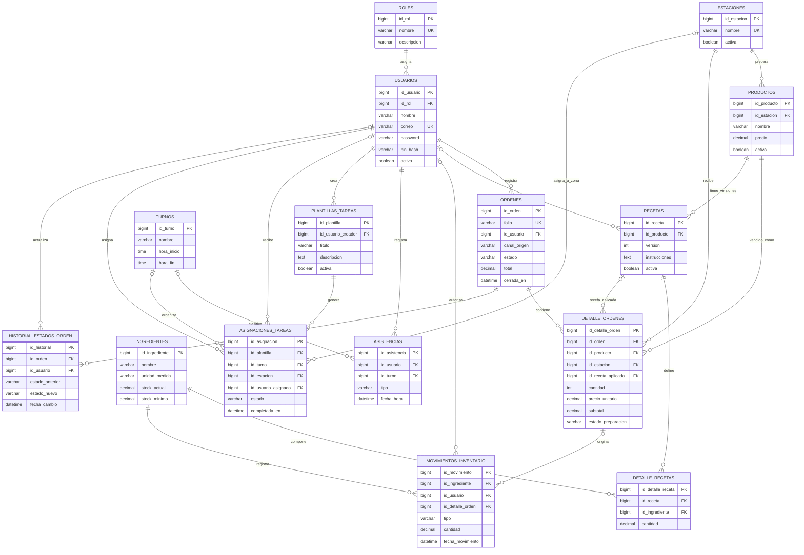
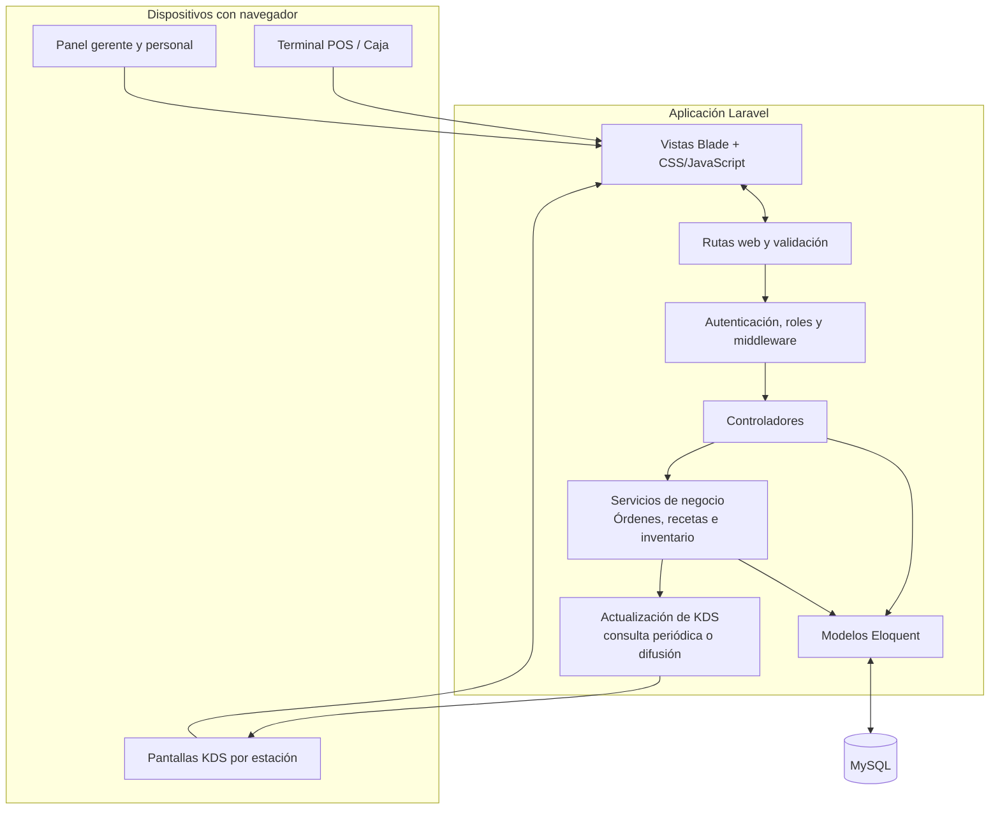
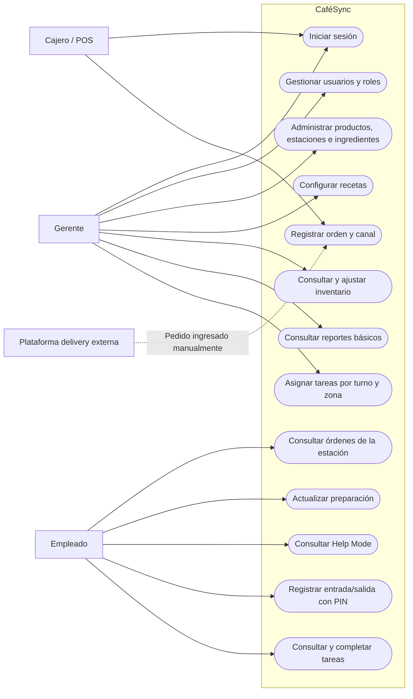
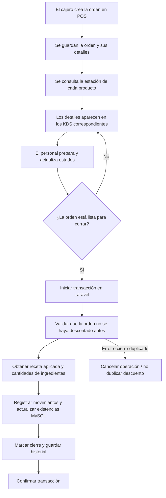

<div align="center">

# ☕ CaféSync
### Plataforma web para coordinar la operación de una cafetería

**Punto de Venta · Pantallas de Preparación · Inventario por Receta · Asistencia · Tareas**

[](https://laravel.com)
[](https://www.php.net)
[](https://laravel.com/docs/blade)
[](https://www.mysql.com)
[](https://git-scm.com)

</div>

> [!NOTE]
> **Estado del documento:** especificación y planificación técnica. Las funciones, diagramas y tablas descritos aquí representan el diseño previsto; no deben considerarse implementados o probados hasta que exista evidencia del desarrollo.

| Ficha del proyecto | Información |
| :--- | :--- |
| **Institución** | Universidad Tecnológica de Torreón |
| **Programa educativo** | Ingeniería en Desarrollo y Gestión de Software |
| **Grado y sección** | 9A TN |
| **Estudiante** | Axel Espinoza Blanco (desarrollo individual) |
| **Profesor** | Jesús Del Toro Robledo |
| **Sistema** | CaféSync — gestión operativa de cafetería |
| **Última actualización del README** | 19 de octubre de 2026 |

---

## ✦ Resumen del proyecto

CaféSync es una propuesta de aplicación web para integrar en un solo flujo la toma de pedidos, la distribución de productos a las estaciones de preparación, la consulta de recetas, el control de ingredientes, el registro de asistencia y la asignación de tareas por turno. La plataforma se plantea para una cafetería que puede recibir solicitudes de mostrador, Drive-Thru y delivery.

El stack definido para el desarrollo es **Laravel + Blade + MySQL**. Laravel gestionará las rutas, la validación, la autenticación, la autorización y las reglas de negocio; Blade compondrá las interfaces web; MySQL conservará las relaciones y el historial operativo.

| Módulo | Propósito |
| :--- | :--- |
| **POS** | Capturar órdenes, productos, cantidades y canal de origen. |
| **KDS** | Mostrar en cada estación los productos que debe preparar y permitir actualizar estados. |
| **Help Mode** | Consultar instrucciones y cantidades de recetas desde la preparación. |
| **Inventario** | Descontar ingredientes por receta y conservar movimientos trazables. |
| **Asistencia** | Registrar entradas y salidas con PIN y hora del servidor. |
| **Tareas** | Asignar listas de limpieza por zona o turno y verificar su cumplimiento. |

### Decisiones técnicas ya definidas

- **Backend y aplicación web:** Laravel (PHP).
- **Vistas:** Blade, con HTML/CSS y JavaScript complementario cuando se requiera interacción en pantalla.
- **Base de datos:** MySQL.
- **Control de versiones y repositorio:** Git y GitHub.
- **Arquitectura:** aplicación web cliente-servidor organizada bajo MVC.
- **Alcance inicial:** un prototipo web para una operación de cafetería; sin integración directa con Rappi/DiDi ni facturación fiscal.

---

## 🧭 Contenido

1. [Introducción y contexto](#1-introducción-y-contexto-del-proyecto)
2. [Planteamiento del problema](#2-planteamiento-del-problema)
3. [Justificación e impacto](#3-justificación-e-impacto-esperado)
4. [Objetivos](#4-objetivos-del-proyecto)
5. [Alcance funcional](#5-alcance-funcional)
6. [Limitaciones](#6-limitaciones-y-elementos-fuera-de-alcance)
7. [MVP](#7-producto-mínimo-viable-mvp)
8. [Usuarios y escenarios](#8-usuarios-roles-y-escenarios-de-operación)
9. [Requisitos funcionales](#9-requisitos-funcionales)
10. [Requisitos no funcionales](#10-requisitos-no-funcionales)
11. [Reglas de negocio](#11-reglas-de-negocio-y-flujos-operativos)
12. [Modelo conceptual de datos](#12-modelo-conceptual-de-datos)
13. [Arquitectura, tecnologías y patrones](#13-arquitectura-tecnologías-y-patrones-de-diseño)
14. [Riesgos](#14-análisis-de-riesgos)
15. [Metodología y responsabilidades](#15-metodología-y-responsabilidades)
16. [Tareas y estimaciones](#16-desglose-de-tareas-y-estimaciones)
17. [Cronograma](#17-cronograma-de-seis-semanas)
18. [Interfaz y contenidos](#18-diseño-de-interfaz-y-definición-de-contenidos)
19. [Plan de pruebas](#19-plan-de-pruebas-y-aceptación)
20. [Entregables y criterios de éxito](#20-entregables-y-criterios-de-éxito)
21. [Glosario](#21-glosario-de-términos)
22. [Diseño de base de datos MySQL](#22-diseño-de-base-de-datos-mysql)
23. [Diccionario de datos](#23-diccionario-de-datos)
24. [Diagramas complementarios](#24-diagramas-complementarios)
25. [Git y GitHub](#25-control-de-versiones-git-y-github)
26. [Flujo de trabajo](#26-flujo-de-trabajo-con-github-flow)
27. [Configuración y ejecución local](#27-configuración-y-ejecución-local)
28. [Seguridad e integridad de datos](#28-seguridad-e-integridad-de-datos)
29. [Referencias técnicas](#29-referencias-técnicas)

---

## 1. Introducción y contexto del proyecto


CaféSync se plantea como una aplicación web orientada a centralizar y coordinar las actividades principales de una cafetería que atiende pedidos de distintas procedencias y prepara productos mediante varias estaciones de trabajo. La propuesta integra un Punto de Venta (POS), pantallas de preparación o Kitchen Display System (KDS), administración de ingredientes por receta, registro de asistencia y asignación de tareas operativas.

El problema que se busca atender no consiste únicamente en capturar ventas. En una operación con mostrador, Drive-Thru y pedidos provenientes de plataformas de entrega, la información debe circular con claridad desde la toma de la orden hasta su preparación y entrega. Al mismo tiempo, la administración requiere conocer el consumo de insumos y tener registros confiables de entradas, salidas, turnos y tareas asignadas.

La idea central de CaféSync es que cada área consulte la información que necesita sin depender de instrucciones verbales o de la retranscripción de un ticket. La caja crea la orden; el sistema identifica su origen y distribuye los productos a las zonas correspondientes; el personal actualiza el estado de preparación; y, al cerrar la venta conforme a la regla definida, se registran los consumos asociados a las recetas. Por separado, el personal registra asistencia mediante PIN y recibe las tareas del turno.

La propuesta se enfoca en una primera versión demostrable, de alcance controlado y desarrollada individualmente. Por esa razón, la integración directa con servicios externos, la facturación fiscal y otras funciones que elevan la complejidad se declaran expresamente fuera del alcance inicial.


> Enfoque del proyecto<br>CaféSync busca mejorar la coordinación y la trazabilidad de la operación diaria de la cafetería mediante una plataforma web compartida, con permisos diferenciados y procesos que puedan verificarse mediante criterios de aceptación.


## 2. Planteamiento del problema


En una cafetería con alta rotación de pedidos pueden coincidir solicitudes de clientes en mostrador, órdenes de Drive-Thru y pedidos recibidos a través de aplicaciones de entrega. Si cada canal se administra de manera separada o se depende de tickets impresos, llamadas y comunicación verbal, la información puede fragmentarse entre caja, baristas, cocina y personal de entrega.

La fragmentación provoca varios tipos de dificultades. Un pedido puede tardar en llegar a la estación correcta; un trabajador puede preparar un producto que no le corresponde; dos personas pueden interpretar de manera distinta las prioridades; y el cajero puede carecer de una forma clara de conocer si una orden está todavía en preparación o lista para entregarse. Estas situaciones aumentan la posibilidad de errores, duplicación de trabajo y demoras, sobre todo en horas pico.

El inventario representa un segundo problema. Llevar un conteo general de productos terminados no basta cuando una bebida o un alimento consume diversos ingredientes en cantidades específicas. Si las ventas no se relacionan con recetas, el registro de existencias puede alejarse del consumo real. Por ejemplo, vender una bebida puede requerir restar una cantidad determinada de café, leche y jarabe; el resultado depende de que la receta y sus unidades de medida estén bien configuradas.

La administración del personal presenta una necesidad paralela. Un registro informal de horarios dificulta determinar cuándo inició y terminó un turno. Del mismo modo, las actividades de limpieza y mantenimiento pueden quedar sujetas a recordatorios verbales, sin un mecanismo común para asignarlas por zona ni para verificar si fueron completadas.

Por tanto, el problema general se define como la falta de un flujo operativo centralizado que conecte la toma de órdenes, la distribución de preparación, el consumo de ingredientes, el control de asistencia y las tareas del turno. CaféSync pretende atender esa necesidad sin convertirse, en su primera versión, en una plataforma de facturación fiscal ni en una integración directa con cada servicio comercial de entrega.


### 2.1. Necesidades identificadas


- Centralizar los pedidos y conservar su canal de origen para facilitar la priorización y la entrega.

- Distribuir automáticamente cada producto a la pantalla o estación que le corresponde, evitando mostrar información irrelevante a cada área.

- Consultar las órdenes y sus estados en pantallas de preparación sin depender de la recarga manual de la página.

- Relacionar la venta con las recetas para calcular y registrar el consumo de ingredientes.

- Conservar marcas de tiempo confiables para la entrada y salida del personal mediante un PIN asociado al empleado.

- Asignar tareas de limpieza por zona o turno y permitir que el trabajador indique su cumplimiento.

- Restringir reportes, ajustes de inventario y otras operaciones administrativas a los perfiles autorizados.


### 2.2. Consecuencias de no atender el problema


Si la información permanece dispersa, los errores de preparación y entrega pueden convertirse en una fuente recurrente de retrabajo. Asimismo, un inventario calculado con datos incompletos reduce la utilidad de las existencias registradas para planificar compras o identificar faltantes. Por último, la ausencia de registros consistentes de asistencia y tareas dificulta revisar incidencias y demostrar qué actividades se realizaron durante un turno.

Estas consecuencias son la motivación del proyecto, no una afirmación de que todas ocurran actualmente en un establecimiento específico. La validación con usuarios o responsables de una cafetería permitiría comprobar la frecuencia de los problemas y ajustar prioridades.


## 3. Justificación e impacto esperado


CaféSync se justifica por la posibilidad de coordinar en una misma plataforma procesos que normalmente requieren varios puntos de comunicación. La propuesta no pretende sustituir el criterio del personal ni eliminar la supervisión; procura entregar información ordenada, reducir capturas repetidas y establecer reglas consistentes para los procesos de trabajo.


### 3.1. Impacto operativo


Al distribuir las órdenes por estación, cada trabajador puede concentrarse en los productos que necesita preparar. Una misma orden puede contener artículos de diferentes áreas, por lo que la división por zona permitirá que cada pantalla presente únicamente las tareas que le corresponden, conservando una referencia común de la orden original. La visibilidad de estados facilitará distinguir entre tareas pendientes, en preparación y listas para el siguiente paso del servicio.

La clasificación por canal también hace posible reconocer de manera visual si una solicitud se originó en mostrador, Drive-Thru o delivery. En el MVP, los pedidos de plataformas externas se capturarán manualmente o se simularán; por tanto, el beneficio inicial proviene de organizar dichos pedidos dentro del mismo flujo, no de automatizar la conexión con Rappi o DiDi.


### 3.2. Impacto en inventario y control administrativo


La relación entre productos vendidos, recetas e ingredientes permite que el sistema calcule consumos con base en cantidades configuradas. Esta automatización puede mejorar la consistencia del inventario y ayudar a reconocer qué insumos requieren reposición. No obstante, el cálculo depende de que las recetas estén completas, que las unidades sean compatibles y que las entradas o correcciones de inventario se registren adecuadamente. El sistema no puede compensar una receta mal capturada ni las mermas que no se documenten.

La información centralizada de ventas, asistencia y tareas puede facilitar la revisión administrativa. Los empleados solo deben ver las funciones necesarias para su trabajo, mientras que el gerente conserva permisos para consultar reportes y administrar los registros críticos, según las funciones que se implementen en la primera versión.


### 3.3. Impacto en capacitación y organización del personal


El modo de ayuda o Help Mode permitirá consultar una ficha visual de la receta desde la pantalla de preparación. Esta función puede servir como apoyo para personal de nuevo ingreso y como recordatorio de cantidades y pasos de elaboración. Los checklists de limpieza, por su parte, ofrecen una manera común de asignar actividades y registrar su cumplimiento por turno o zona.


### 3.4. Beneficiarios


| Beneficiario | Beneficio esperado | Condición para que el beneficio ocurra |
| --- | --- | --- |
| Cajero | Captura estructurada y clasificación visible de pedidos. | Catálogo actualizado, interfaz clara y capacitación breve. |
| Barista y personal de preparación | Visualización de tareas pertinentes y consulta de recetas. | Ruteo correcto de productos y pantallas disponibles. |
| Gerente | Mayor visibilidad de ventas, existencias, asistencias y tareas. | Roles bien configurados y registros completos. |
| Cliente | Menor probabilidad de confusión durante la preparación y entrega. | Flujo de trabajo coordinado y estados actualizados. |
| Responsable del proyecto | Alcance y criterios que permiten verificar el prototipo. | Pruebas documentadas y control de cambios. |


## 4. Objetivos del proyecto


### 4.1. Objetivo general


Desarrollar un sistema web operativo para cafeterías que integre un Punto de Venta (POS), pantallas de preparación (KDS) segmentadas por zonas, control de inventario basado en recetas y herramientas básicas para gestionar roles, asistencias y tareas del personal, con el propósito de agilizar el flujo de las órdenes, mejorar la consistencia de los registros y facilitar la supervisión de la operación diaria.


### 4.2. Objetivos específicos


1. Diseñar e implementar un flujo de venta que permita capturar los productos de una orden e identificar si proviene de mostrador, Drive-Thru o delivery.

2. Definir una organización de estaciones de preparación, de modo que cada producto se envíe a la zona asociada y el personal consulte únicamente los elementos que debe elaborar.

3. Actualizar las pantallas KDS cuando se genere o modifique una orden, buscando que la información aparezca en menos de un segundo bajo las condiciones del entorno de prueba.

4. Incorporar un Help Mode que presente los pasos y cantidades de las recetas disponibles desde el contexto de preparación.

5. Relacionar los productos del menú con ingredientes y cantidades de receta para calcular el consumo correspondiente al cierre de una venta.

6. Implementar autenticación y permisos diferenciados para gerente y empleado, evitando que el segundo acceda a reportes o ajustes administrativos no autorizados.

7. Permitir que cada empleado registre entrada y salida mediante un PIN vinculado a su perfil y con la hora tomada del servidor.

8. Crear un mecanismo de asignación y seguimiento de tareas de limpieza por zona o turno, mediante listas de verificación.

9. Establecer criterios de aceptación y casos de prueba para comprobar el flujo de pedidos, la distribución por estación, el descuento de inventario y los controles de acceso.


### 4.3. Resultados observables


Los objetivos se considerarán demostrados cuando exista un flujo reproducible que permita iniciar sesión según el rol, registrar asistencia, capturar una orden, verla en las estaciones correctas, actualizar sus estados, cerrar la venta y comprobar el movimiento de ingredientes previsto en la receta. Las funciones complementarias deberán probarse por separado y no se considerarán obligatorias para declarar terminado el núcleo del MVP.


## 5. Alcance funcional


El alcance comprende el diseño, desarrollo y validación de un prototipo web centrado en el flujo interno de una cafetería. El sistema se utilizará desde navegador y estará pensado para una caja y varios dispositivos de preparación conectados a un servidor común dentro de una red disponible.


### 5.1. Módulos contemplados


| Módulo | Funciones comprendidas | Consideraciones |
| --- | --- | --- |
| Acceso y roles | Inicio de sesión y autorización según perfil de gerente o empleado. | La autorización debe verificarse en el servidor y no solo ocultar botones. |
| Punto de Venta (POS) | Selección de productos, construcción de la orden, canal de origen y envío a preparación. | El registro interno de cierre de venta no equivale a una pasarela de pago. |
| Clasificación de órdenes | Etiqueta visual para mostrador, Drive-Thru y delivery. | Los pedidos de aplicaciones se capturan o simulan manualmente. |
| Pantallas KDS | Recepción de órdenes, filtrado por estación y actualización de estado. | El mecanismo exacto de actualización en tiempo real deberá validarse técnicamente. |
| Recetas / Help Mode | Consulta de cantidades y pasos asociados a productos. | La información visible depende de recetas cargadas y revisadas. |
| Inventario por receta | Registro de ingredientes y consumo automático al cerrar la venta. | Las unidades y cantidades deben validarse; las correcciones requieren autorización. |
| Asistencia | Registro de entrada y salida con PIN y hora de servidor. | No se contempla reconocimiento facial ni biométrico. |
| Tareas por turno | Asignación de checklists de limpieza y marcado de cumplimiento. | La asignación puede limitarse al conjunto de tareas configurado. |
| Supervisión | Acceso gerencial a datos y funciones administrativas contempladas. | Reportes avanzados quedan sujetos a disponibilidad de tiempo y alcance del MVP. |


### 5.2. Flujo general incluido


1. El usuario autorizado inicia sesión en el sistema. El empleado también puede acceder al módulo de asistencia para registrar su movimiento mediante PIN, conforme al diseño adoptado.

2. El cajero selecciona los productos, indica el canal de origen de la orden y confirma su envío al flujo de preparación.

3. El sistema conserva la orden principal y distribuye sus productos a las estaciones correspondientes, sin duplicar conceptualmente la venta original.

4. Cada estación consulta los productos que le fueron asignados, abre la ficha de ayuda cuando necesita verificar la receta y actualiza el estado de preparación.

5. El cajero o personal autorizado identifica cuándo la orden está lista para entrega. Al cerrar la venta según el proceso definido, se registran los consumos calculados a partir de las recetas.

6. El gerente puede revisar los registros administrativos y asignar tareas por turno; el empleado consulta su checklist y marca las actividades completadas.


### 5.3. Supuestos de operación


- Los productos del menú, ingredientes, estaciones y recetas se registran antes de operar el flujo completo.

- Cada producto que deba mostrarse en una estación tiene asociada una regla de ruteo clara.

- La red local o la conexión necesaria entre los dispositivos y el servidor se encuentra activa.

- El responsable de la cafetería define el momento exacto de cierre de la venta y las reglas para cancelaciones o correcciones posteriores.

- Los usuarios utilizan sus propias credenciales o PIN y no comparten sus accesos.


## 6. Limitaciones y elementos fuera de alcance


Las limitaciones se establecen para mantener viable el desarrollo individual y evitar que las integraciones externas o la infraestructura de producción impidan completar el proceso básico. Una función excluida no deberá interpretarse como una capacidad disponible en la primera entrega.


| Elemento | Límite de la primera versión | Implicación práctica |
| --- | --- | --- |
| Plataformas de delivery | No habrá conexión directa con las API reales de Rappi o DiDi. | El pedido se registrará manualmente o con datos simulados y una etiqueta visual. |
| Facturación fiscal | No se generarán CFDI ni facturas oficiales para el SAT. | CaféSync no sustituirá un sistema de facturación autorizado. |
| Pagos externos | No se contempla integrar una pasarela ni procesar pagos electrónicos con terceros. | El POS se enfocará en registrar la orden y su cierre operativo. |
| Conectividad | La comunicación entre caja y KDS depende de una red local o conexión activa. | Una interrupción puede impedir la actualización inmediata; se requiere plan de contingencia. |
| Aplicación nativa | No se desarrollarán aplicaciones independientes para iOS o Android. | El acceso será mediante navegador compatible. |
| Hardware especializado | No se garantiza compatibilidad con impresoras, cajones, lectores o terminales específicos. | Cualquier periférico requerirá prueba y configuración adicional. |
| Nómina / recursos humanos | No se incluye cálculo de nómina, prestaciones, impuestos ni gestión laboral integral. | Las marcas de asistencia son registros operativos, no una nómina oficial. |
| Pronósticos avanzados | No se incluyen predicción de demanda, análisis de rentabilidad ni inteligencia artificial. | Los reportes avanzados pueden considerarse en versiones futuras. |
| Inventario multisucursal | No se plantea administrar transferencias entre sucursales o almacenes múltiples. | El modelo inicial se concentra en una operación de cafetería. |
| Acceso fuera de línea | No se garantiza operación completa sin servidor o red disponible. | La reconexión automática y un ticket de emergencia son mitigaciones, no sustitutos de un modo offline completo. |


> Decisión de alcance<br>Si el tiempo se reduce, se deberán recortar primero los complementos y conservar el flujo principal: acceso, asistencia, POS, distribución KDS y descuento correcto de inventario. No se debe sacrificar la integridad de los datos para aparentar que una mayor cantidad de módulos está terminada.


## 7. Producto Mínimo Viable (MVP)


El Producto Mínimo Viable corresponde a la versión más pequeña que permite demostrar el beneficio principal del proyecto con un flujo integrado. La prioridad se define por dependencia funcional: sin usuarios y datos base no puede administrarse el sistema; sin POS no hay órdenes que distribuir; y sin recetas no puede validarse el descuento por consumo.


### 7.1. Funcionalidades indispensables (P1)


| Orden | Funcionalidad P1 | Condición mínima de aceptación |
| --- | --- | --- |
| 1 | Acceso con roles y reloj checador. | Gerente y empleado pueden autenticarse conforme a su rol; el PIN registra la entrada/salida del empleado correcto con hora de servidor. |
| 2 | Punto de Venta básico. | Una orden puede capturarse con productos y canal de origen, guardarse y enviarse al flujo de preparación. |
| 3 | Pantallas KDS por zona. | La orden aparece sin recarga manual en la estación correspondiente y el personal puede marcarla como lista. |
| 4 | Inventario por receta. | Al cerrar la venta, el sistema descuenta las cantidades configuradas y conserva el movimiento asociado. |
| 5 | Separación de permisos. | El empleado no puede consultar reportes gerenciales ni ejecutar cambios administrativos de inventario. |
| 6 | Datos base de prueba. | Existen productos, ingredientes, recetas y estaciones suficientes para demostrar el flujo completo. |


### 7.2. Funcionalidades complementarias (P2)


- Gestión más completa de checklists por zonas y turnos, incluyendo recurrencia, revisión del gerente e historial detallado.

- Reportes administrativos adicionales, filtros por periodo y exportaciones.

- Alertas de existencias bajas y validaciones previas a la venta cuando no alcance un ingrediente.

- Impresión de tickets de contingencia si se dispone de una impresora compatible y se valida su conexión.

- Mejora de reconexión y recuperación de órdenes cuando se interrumpe temporalmente la red.

- Historial ampliado de cambios y herramientas adicionales para revisar ajustes de inventario.

> **Nota:** Los elementos P2 son ampliaciones recomendadas y no reemplazan las funcionalidades prioritarias. Su incorporación se decidirá después de probar el flujo P1; no deben darse por comprometidos solo por aparecer en este documento.


### 7.3. Criterio de validación global del MVP


Se utilizará un caso de prueba de extremo a extremo: un usuario inicia sesión; el empleado registra asistencia; el cajero captura una orden con al menos dos productos destinados a zonas distintas; cada pantalla recibe exclusivamente los productos que le corresponden; se consulta una receta; se completa y cierra la venta; y el inventario refleja las cantidades descontadas en cada ingrediente. Finalmente, se comprueba que un empleado no pueda abrir ni ejecutar las funciones reservadas al gerente.


## 8. Usuarios, roles y escenarios de operación


### 8.1. Actores principales


| Actor | Responsabilidades previstas | Acceso / restricciones |
| --- | --- | --- |
| Gerente | Administrar información operativa, revisar ventas e inventario, mantener recetas y productos, gestionar usuarios y asignar tareas. | Acceso a las funciones administrativas autorizadas. Las acciones críticas deben validar permisos y registrar cambios cuando corresponda. |
| Cajero | Capturar órdenes, seleccionar canal de origen y dar seguimiento al flujo de venta. | No debe modificar parámetros críticos de inventario ni consultar información gerencial si su cuenta no tiene ese permiso. |
| Empleado de preparación | Consultar los productos asignados a su zona, revisar el Help Mode y actualizar estados de preparación. | Solo ve la información pertinente para su estación y las tareas que le hayan sido asignadas. |
| Empleado en reloj checador | Registrar entrada y salida mediante su PIN asociado. | El sistema identifica el perfil correspondiente y utiliza la hora del servidor. |
| Responsable técnico del proyecto | Configurar el entorno, desarrollar, probar y documentar la solución. | Es el responsable de implementación; no constituye un rol operativo adicional del negocio. |

Los roles anteriores describen responsabilidades lógicas. En la implementación, cajero y empleado de preparación podrían formar parte del rol general “Empleado” si se decide mantener solo dos perfiles en el MVP. En ese caso, las pantallas limitarán las acciones según el contexto de uso, mientras que el gerente conservará las funciones administrativas.


#### 8.2. Escenario A: pedido de mostrador


El cajero registra los productos, establece el origen como mostrador y envía la orden. CaféSync distribuye los artículos a las estaciones responsables. Cada una prepara su parte y actualiza el estado correspondiente. Cuando todos los artículos necesarios se han completado, el personal identifica la orden como lista para entrega. El flujo debe mantener una referencia común a la orden para evitar que sus componentes se confundan con ventas distintas.


#### 8.3. Escenario B: pedido de Drive-Thru


El cajero selecciona Drive-Thru como canal. La etiqueta del pedido permite reconocer su procedencia en las pantallas sin que el canal cambie la receta ni la zona de preparación de cada producto. El sistema debe conservar el canal de origen durante las transiciones de estado, de manera que el personal pueda distinguir una orden de entrega vehicular de una orden de mostrador.


#### 8.4. Escenario C: pedido de delivery


El pedido recibido desde una plataforma externa se captura manualmente o mediante información de prueba. Se identifica como delivery con la etiqueta visual correspondiente. CaféSync organiza la preparación interna, pero no confirma ni sincroniza automáticamente el estado del pedido con Rappi o DiDi, ya que esa integración se encuentra fuera del alcance inicial.


#### 8.5. Escenario D: consulta de receta


Durante la preparación, el trabajador abre la ayuda asociada al producto. La tarjeta debe mostrar el nombre de la receta, cantidades y pasos disponibles con una estructura fácil de leer desde una pantalla de trabajo. La ayuda debe cerrarse o volver a la orden sin perder la referencia del producto que se estaba preparando.


#### 8.6. Escenario E: asistencia y tareas


El empleado introduce su PIN en el punto habilitado y el sistema registra la acción con la hora del servidor. En el turno, puede consultar el checklist asignado a su zona, marcar cada actividad como realizada y guardar el cambio. El gerente debe poder identificar las actividades pendientes y revisar el estado registrado, de acuerdo con el grado de detalle implementado.


## 9. Requisitos funcionales


Los requisitos funcionales describen las acciones que el sistema debe permitir. Cada criterio de aceptación define una evidencia observable que podrá comprobarse en pruebas. La prioridad P1 corresponde al flujo indispensable; P2 identifica una ampliación o una función que debe implementarse después de estabilizar el núcleo.


| ID | Requisito | Descripción | Criterio de aceptación | Prioridad |
| --- | --- | --- | --- | --- |
| RF-01 | Autenticación y roles | El sistema permitirá iniciar sesión y asociar la sesión a un perfil de gerente o empleado. | Con credenciales válidas se abre el módulo autorizado; sin sesión válida no se accede a pantallas privadas. | P1 |
| RF-02 | Clasificación de órdenes | El cajero podrá indicar si la orden procede de mostrador, Drive-Thru o delivery. | La orden conserva el canal seleccionado y la etiqueta correspondiente se observa en POS y KDS. | P1 |
| RF-03 | Captura de venta | El cajero podrá seleccionar productos, revisar la orden y confirmar su envío. | La orden guardada contiene los productos y cantidades capturados, y recibe un identificador consultable. | P1 |
| RF-04 | Enrutamiento por estación | El sistema distribuirá cada producto a la zona configurada para prepararlo. | En una orden de prueba con bebida y alimento, cada estación muestra solo el artículo que le corresponde. | P1 |
| RF-05 | Actualización del KDS | Las pantallas recibirán órdenes nuevas y permitirán actualizar el estado de preparación. | Una orden enviada aparece sin recarga manual y el cambio a “lista” persiste al volver a consultar. | P1 |
| RF-06 | Help Mode | El empleado podrá abrir la ficha de receta desde el producto mostrado en su estación. | La ficha presenta los pasos y cantidades configurados para el producto seleccionado. | P1 |
| RF-07 | Configuración de recetas | El sistema relacionará cada producto con los ingredientes y cantidades necesarias para prepararlo. | Una receta de prueba identifica cada ingrediente, cantidad y unidad definida; los datos se conservan al guardarse. | P1 |
| RF-08 | Descuento por receta | Al cerrar una venta, el sistema registrará el consumo de ingredientes según las recetas de los productos vendidos. | Los saldos cambian por las cantidades esperadas y no se genera un segundo descuento si se repite una consulta o acción ya completada. | P1 |
| RF-09 | Consulta y modificación administrativa de inventario | El gerente podrá consultar existencias y efectuar los ajustes contemplados en el módulo. | El gerente puede ejecutar la operación autorizada y el perfil empleado recibe una denegación al intentar hacerlo. | P1 |
| RF-10 | Registro de asistencia | El empleado podrá registrar entrada y salida con un PIN vinculado a su perfil. | El registro identifica al empleado y usa la hora del servidor, no una hora libre capturada por el navegador. | P1 |
| RF-11 | Asignación y cumplimiento de tareas | El gerente podrá asignar tareas por zona o turno y el empleado podrá marcar su cumplimiento. | La tarea asignada aparece en la vista del empleado y el estado guardado sigue visible al abrir de nuevo la lista. | P1 |
| RF-12 | Protección de reportes y administración | El sistema restringirá los reportes de ventas y las acciones críticas a perfiles autorizados. | Una solicitud no autorizada es bloqueada por el servidor, aunque el usuario intente entrar directamente a la ruta. | P1 |
| RF-13 | Reporte operativo de ventas | El gerente podrá consultar los datos de venta incluidos en los reportes básicos que se implementen. | Los totales presentados coinciden con el conjunto de ventas de prueba seleccionado. | P2 |
| RF-14 | Aviso de bajo inventario | El sistema podrá alertar cuando una existencia alcance un umbral definido. | Un ingrediente de prueba por debajo del umbral muestra una alerta clara sin modificar el saldo automáticamente. | P2 |
| RF-15 | Reconexión / contingencia | El sistema intentará recuperar la comunicación de las pantallas cuando vuelva la red y podrá apoyarse en un ticket de emergencia si existe hardware compatible. | La recuperación no duplica órdenes ni movimientos de inventario; la impresión se prueba solo si el equipo está disponible. | P2 |

> **Nota:** RF-09 y RF-13 detallan funciones administrativas que en la propuesta inicial se relacionan con la separación de permisos. Su implementación debe priorizarse después de comprobar el flujo P1 esencial y el tiempo disponible. RF-14 y RF-15 se consideran complementarios para no comprometer la entrega principal.


## 10. Requisitos no funcionales


Los requisitos no funcionales describen condiciones de calidad, seguridad y operación. Para que resulten útiles, deben vincularse con una forma de comprobación y con las condiciones del entorno de prueba.


| ID | Atributo | Requisito | Verificación | Prioridad |
| --- | --- | --- | --- | --- |
| RNF-01 | Tiempo de actualización | Las órdenes nuevas deberán aparecer en la pantalla KDS en menos de 1 segundo desde su envío en condiciones normales de la red de prueba. | Registrar marcas de tiempo de envío y visualización en una serie de pruebas documentadas. | P1 |
| RNF-02 | Seguridad por rol | El usuario empleado no accederá a reportes gerenciales ni a la modificación administrativa del inventario. | Intentar acceso desde interfaz y mediante ruta directa; en ambos casos la operación no autorizada debe bloquearse. | P1 |
| RNF-03 | Usabilidad táctil | Los controles principales de POS y KDS serán legibles y utilizables en pantallas de 1920 × 1080 y con interacción táctil. | Probar el flujo principal sin que los botones críticos se encimen ni dependan de precisión excesiva. | P1 |
| RNF-04 | Integridad transaccional | La venta y sus movimientos de ingredientes deberán guardarse de forma consistente. | Simular una falla o repetición de solicitud y comprobar que no queden descuentos parciales o duplicados. | P1 |
| RNF-05 | Consistencia de unidades | Las recetas deberán utilizar unidades definidas y compatibles con las existencias del ingrediente. | Validar ejemplos en gramos, mililitros y unidades, y contrastar el resultado con cálculos manuales. | P1 |
| RNF-06 | Validación de datos | Los formularios verificarán campos obligatorios, cantidades válidas y valores numéricos antes de guardar. | Enviar formularios incompletos o valores inválidos y comprobar mensajes comprensibles y ausencia de registros incorrectos. | P1 |
| RNF-07 | Confidencialidad de credenciales | Las contraseñas y PIN se protegerán mediante mecanismos adecuados de almacenamiento y verificación; las sesiones deberán contar con controles de acceso. | Inspeccionar la persistencia y verificar que los secretos no se presenten en texto plano ni se envíen a vistas no autorizadas. | P1 |
| RNF-08 | Disponibilidad de red | El flujo de caja y las pantallas requiere conectividad con el servidor. | Documentar el comportamiento ante pérdida de comunicación y comprobar que el usuario recibe una indicación clara. | P1 |
| RNF-09 | Mantenibilidad | La lógica de pedidos, receta e inventario se mantendrá separada de la presentación cuando el diseño lo permita. | Revisar la organización del código y confirmar que una corrección del cálculo no obliga a duplicar reglas en cada pantalla. | P2 |
| RNF-10 | Rendimiento de consulta | Las pantallas principales deben responder de forma fluida con un conjunto representativo de productos, ingredientes y órdenes de prueba. | Registrar tiempos de consulta en el entorno definido y revisar consultas que degraden el flujo. | P2 |

La meta de menos de un segundo se considera un objetivo de diseño bajo condiciones normales de prueba, no una garantía ante cualquier tipo de conexión, dispositivo o carga. Se debe registrar el entorno en el que se realizaron las mediciones para interpretar correctamente los resultados.


## 11. Reglas de negocio y flujos operativos


Las reglas de negocio convierten los objetivos generales en decisiones concretas. Las siguientes reglas son una especificación propuesta para completar los puntos que la descripción inicial deja abiertos; deberán confirmarse antes de codificar los casos límite.


### 11.1. Reglas propuestas para las órdenes


1. Cada orden debe contar con un identificador único y conservar su canal de origen durante todo el flujo.

2. Cada producto del menú debe tener asignada una estación o regla explícita de enrutamiento. Si un producto no tiene estación definida, el sistema debe señalarlo al gerente o impedir su envío silencioso.

3. Una orden puede generar elementos de preparación para más de una zona, pero todos deben conservar la relación con la misma orden principal.

4. Los estados que se presenten al usuario deben ser consistentes en POS y KDS. Para el MVP se propone manejar, como mínimo, pendiente, en preparación y lista; la entrega y cancelación se incluirán si se definen dentro del flujo implementado.

5. Los cambios de estado deben persistir en la base de datos y ser visibles al volver a consultar la orden.

6. Los pedidos de delivery ingresados manualmente deben identificarse como tales sin afirmar que fueron recibidos o sincronizados mediante una API externa.


### 11.2. Reglas propuestas para recetas e inventario


1. Cada receta debe vincular un producto vendible con uno o más ingredientes y una cantidad por unidad del producto.

2. Las cantidades de receta y las existencias deben expresarse en unidades compatibles. Si una receta utiliza mililitros, no debe descontarse directamente de un saldo expresado en litros sin una conversión definida.

3. El descuento del inventario se realizará en el punto de cierre de venta acordado. Crear una orden no debe producir un descuento irreversible si todavía no se ha concretado la venta.

4. Cada consumo debe asociarse a la venta que lo originó, para permitir revisar el cálculo ante una discrepancia.

5. La misma venta no puede descontar sus recetas dos veces por reintentos de una solicitud o actualización de pantalla.

6. Los ajustes manuales de inventario deben estar restringidos al gerente y registrar el ingrediente afectado, la cantidad, el tipo de movimiento y una observación si el diseño lo contempla.

7. La cancelación o corrección de una venta ya cerrada requiere una regla explícita de reversión o ajuste autorizado. No se asumirá que basta con borrar la orden.


### 11.3. Reglas propuestas para asistencia y tareas


- El PIN debe resolver a un único perfil de empleado activo; un PIN inválido no debe generar un registro de asistencia.

- La fecha y hora del registro procederán del servidor para reducir inconsistencias entre dispositivos.

- Los registros de asistencia deben conservar el tipo de movimiento (entrada o salida) y la referencia del empleado.

- Las tareas deben estar asociadas a una zona o turno, y su cumplimiento debe guardar quién la marcó y cuándo, en la medida en que el modelo implementado lo permita.

- El empleado podrá marcar sus tareas asignadas, pero no deberá alterar la definición global del checklist ni las tareas de otros trabajadores fuera de los permisos que se le otorguen.


> Punto por confirmar antes de implementar<br>Definir de forma explícita qué ocurre cuando una orden se cancela, se modifica después de enviarse a cocina o se cierra más de una vez. También debe decidirse cómo se reporta una falta de ingredientes y si se permitirá cerrar una venta cuando una receta no esté configurada. Estas decisiones afectan directamente la integridad del inventario.


## 12. Modelo conceptual de datos


La propuesta inicial establece que habrá una base de datos relacional, pero no presenta un diagrama completo de tablas. Por ello, la siguiente lista constituye un modelo conceptual sugerido, útil para iniciar el diseño y revisar las relaciones; no representa un esquema ya implementado ni fija nombres definitivos de columnas.


| Entidad conceptual | Información principal | Relaciones relevantes |
| --- | --- | --- |
| Usuarios | Credenciales, estado de cuenta y referencia al rol. | Se relaciona con el rol asignado y puede vincularse con acciones administrativas. |
| Roles | Nombre del perfil y permisos permitidos. | Un rol puede estar asociado a varios usuarios. |
| Empleados | Identificación interna y estado laboral operativo; PIN protegido o referencia de verificación. | Se vincula con asistencia, tareas asignadas y posiblemente con el usuario de acceso. |
| Productos del menú | Nombre, descripción, precio vigente, estado y estación o regla de preparación. | Se relacionan con líneas de venta y con recetas. |
| Estaciones | Nombre de zona, tipo de preparación y estado de disponibilidad. | Una estación recibe tareas de preparación de productos configurados. |
| Órdenes | Identificador, canal, fecha/hora, estado general e importe de referencia. | Contienen líneas de venta y se relacionan con sus movimientos de inventario. |
| Detalle de orden | Producto, cantidad y precio aplicado al momento de la venta. | Cada línea corresponde a una orden y a un producto. |
| Ingredientes | Nombre, unidad base, existencia y estado. | Se relacionan con recetas y con movimientos de inventario. |
| Recetas | Producto, versión o estado de configuración e instrucciones de preparación. | Relacionan el producto con los ingredientes y sus cantidades. |
| Ingredientes por receta | Ingrediente, cantidad y unidad necesaria por producto. | Permite modelar la relación de muchos a muchos entre productos e ingredientes. |
| Movimientos de inventario | Ingrediente, cantidad de entrada/salida, motivo, fecha y referencia origen. | Se relacionan con el ingrediente y, para el consumo de receta, con la venta que lo originó. |
| Registros de asistencia | Empleado, tipo de marca, fecha/hora y referencia del método usado. | Cada registro corresponde a un empleado. |
| Tareas de limpieza | Nombre, instrucciones, zona, frecuencia o turno y estado de configuración. | Se relacionan con asignaciones a empleados o turnos. |
| Asignaciones de tarea | Tarea asignada, zona/turno, empleado responsable si aplica, estado y marca de cumplimiento. | Permite consultar el avance de las actividades del turno. |


### 12.1. Relaciones que requieren especial cuidado


- Una orden tiene múltiples líneas de detalle; cada línea identifica el producto y la cantidad que se venderá.

- Un producto puede requerir varios ingredientes y un ingrediente puede utilizarse en varias recetas. Esta relación debe resolverse con una entidad intermedia de cantidades.

- Los movimientos de inventario constituyen el historial de cambios de las existencias. Es preferible conservarlos para auditoría en lugar de modificar saldos sin una referencia explicativa.

- Las marcas de asistencia pertenecen a un empleado, pero el usuario de acceso y el registro laboral no tienen por qué ser la misma entidad.

- Las tareas de limpieza pueden definirse de forma general y asignarse a distintos turnos; separar la tarea de su asignación facilita reutilizar los checklists.


### 12.2. Integridad y tipos de datos


Los importes deben almacenarse con un tipo numérico adecuado para valores monetarios, no como texto. Las cantidades de ingredientes requieren precisión suficiente para medir gramos y mililitros. Las relaciones principales deben protegerse mediante claves y restricciones consistentes, y las operaciones de cierre de venta y descuento de recetas deben tratarse como una unidad lógica para evitar que el sistema guarde una parte del proceso y omita otra.

El motor relacional definido para CaféSync es **MySQL**. El diagrama físico propuesto se detalla en el apartado 22 y deberá implementarse mediante migraciones de Laravel. Antes de programar la lógica de inventario, se revisarán especialmente las relaciones entre órdenes, detalles, recetas, ingredientes, estaciones y movimientos de inventario.


## 13. Arquitectura, tecnologías y patrones de diseño


### 13.1. Arquitectura propuesta


Se plantea una arquitectura cliente-servidor: los navegadores de caja, estaciones de preparación y administración se conectan a una aplicación central que ejecuta la lógica de negocio y consulta la base de datos relacional. Este enfoque permite compartir el estado de las órdenes entre dispositivos y aplicar una política común de permisos.

La aplicación se organizará como un proyecto **Laravel** integrado, con rutas, controladores, modelos Eloquent, validaciones y vistas **Blade**. La persistencia se realizará en **MySQL** y se administrará mediante migraciones. Docker podrá utilizarse para reproducir el entorno local cuando se prepare la configuración correspondiente. La interfaz KDS requiere actualizarse sin recarga manual; se probará primero el mecanismo de actualización y, si no permite cumplir la meta de tiempo, se evaluará Laravel Broadcasting/Reverb como complemento sin cambiar el stack principal.


### 13.2. Componentes tecnológicos propuestos


| Componente | Tecnología o enfoque | Función dentro del proyecto |
| --- | --- | --- |
| Aplicación / backend | Laravel (PHP). | Gestionar rutas, sesiones, validaciones, permisos, reglas de venta, recetas e inventario. |
| Interfaz web | **Blade** (motor de plantillas de Laravel), HTML, CSS y JavaScript complementario. | Construir POS, KDS, pantallas de ayuda, asistencia y tareas sin mantener un frontend separado. |
| Actualización del KDS | Mecanismo de actualización sin recarga, por definir tras prueba técnica. | Reflejar nuevas órdenes y estados dentro de la meta de tiempo establecida. |
| Persistencia | **MySQL** con migraciones de Laravel y Eloquent ORM. | Conservar usuarios, ventas, productos, ingredientes, recetas y registros operativos. |
| Contenedores | Docker. | Reproducir el entorno de ejecución y facilitar configuración del proyecto. |
| Control de versiones | Git. | Registrar cambios, recuperar versiones funcionales y apoyar la organización individual. |
| Pruebas | Casos manuales documentados y, cuando sea viable, pruebas automatizadas. | Verificar reglas de negocio, cálculos, permisos, persistencia y flujo de extremo a extremo. |


### 13.3. Flujo técnico general


1. El navegador envía una acción al backend mediante una ruta autorizada.

2. Laravel valida la sesión, el rol y los datos recibidos antes de ejecutar la operación.

3. La lógica de negocio coordina la creación de la orden, el detalle de productos y el cálculo que corresponda.

4. La base de datos conserva la operación y sus relaciones mediante una transacción cuando se trate de cambios que deban permanecer consistentes.

5. El sistema comunica el cambio a las pantallas pertinentes; estas consultan la información actualizada y presentan el estado al usuario.


### 13.4. Patrones y mecanismos de diseño


| Patrón / mecanismo | Uso previsto | Precaución de implementación |
| --- | --- | --- |
| Observer (Observador) | Representar la reacción a un evento de dominio, por ejemplo, una orden enviada o un cambio de estado. | Un evento en el backend no actualiza por sí solo el navegador; debe conectarse con el mecanismo de difusión o consulta elegido. |
| Middleware | Comprobar sesión y autorización antes de entrar a rutas protegidas. | El permiso también debe revisarse en las acciones del servidor; ocultar controles no constituye seguridad. |
| Repository (Repositorio) | Separar las operaciones de consulta y persistencia de ingredientes y movimientos cuando la complejidad lo justifique. | No introducir capas innecesarias para cada tabla si una solución más simple es suficiente para el MVP. |
| Servicio de dominio | Concentrar el cálculo del consumo por receta y la regla de cierre de venta. | Evitar que el mismo descuento esté duplicado en varios controladores. |
| Transacción de base de datos | Agrupar el cierre de venta y los movimientos relacionados para evitar resultados parciales. | Definir cómo se manejan errores y reintentos sin duplicar el consumo. |


### 13.5. Seguridad y administración del entorno


- Las rutas administrativas deberán comprobar la sesión y el rol en el servidor.

- Los PIN y contraseñas no deben almacenarse como texto plano; la implementación debe utilizar el mecanismo de hash/verificación apropiado para cada tipo de credencial.

- El proyecto no deberá incluir credenciales reales ni secretos de configuración dentro del repositorio.

- Los mensajes de error deben ayudar al usuario a continuar sin revelar trazas internas, credenciales o información técnica sensible.

- Los respaldos y la recuperación de datos son consideraciones necesarias antes de una instalación operativa, aunque su automatización queda fuera del MVP si el tiempo no lo permite.


## 14. Análisis de riesgos


La matriz de riesgos considera problemas técnicos y de organización que pueden retrasar o debilitar el flujo principal. Las valoraciones de probabilidad e impacto son estimaciones iniciales y deberán actualizarse cuando existan pruebas reales de red, rendimiento y recetas.


| ID | Riesgo | Prob. | Impacto | Prevención / mitigación | Contingencia |
| --- | --- | --- | --- | --- | --- |
| R-01 | Falla o inestabilidad de internet/red local durante hora pico. | Media | Alto | Probar reconexión, mostrar el estado de conexión y mantener una contingencia operativa documentada. | Si la pantalla deja de actualizarse, comunicarlo; usar ticket de emergencia solo si existe impresora configurada. |
| R-02 | Las órdenes no llegan a las estaciones dentro del tiempo esperado. | Media | Alto | Validar temprano el mecanismo de actualización y medir el tiempo entre envío y visualización. | Reducir complejidad visual, revisar consultas y desactivar funciones no esenciales que afecten el flujo. |
| R-03 | Recetas incompletas o unidades incompatibles generan descuentos incorrectos. | Media | Alto | Validar recetas con ejemplos manuales y definir unidad base por ingrediente. | Corregir la receta y registrar ajuste autorizado; conservar la referencia del movimiento afectado. |
| R-04 | Un reintento o doble clic descuenta ingredientes más de una vez. | Media | Alto | Diseñar el cierre de venta como operación idempotente y transaccional. | Bloquear la repetición y revisar el historial antes de ejecutar un ajuste. |
| R-05 | Un empleado accede a una pantalla o acción administrativa. | Baja/Media | Alto | Aplicar middleware y validación de autorización en cada operación crítica. | Revocar sesión, corregir el permiso y ejecutar nuevamente las pruebas de acceso directo. |
| R-06 | El PIN se comparte o permite identificar incorrectamente al empleado. | Media | Medio | Vincular el PIN a un solo perfil y proteger su almacenamiento y consulta. | Invalidar o reemplazar el PIN comprometido conforme a la política que defina el sistema. |
| R-07 | Los empleados encuentran compleja la nueva interfaz. | Media | Bajo/Medio | Diseñar controles grandes, etiquetas directas y ayuda contextual. | Simplificar pantallas, corregir textos y priorizar las acciones frecuentes. |
| R-08 | El alcance crece más rápido que la capacidad de desarrollo individual. | Alta | Alto | Mantener backlog, prioridad P1/P2 y entregas semanales verificables. | Aplazar complementos sin sacrificar las pruebas del flujo principal. |
| R-09 | La base de datos se vuelve lenta en consultas repetidas. | Baja/Media | Alto | Revisar consultas, relaciones e índices con datos de prueba representativos. | Optimizar la consulta crítica antes de añadir módulos secundarios. |
| R-10 | Las tareas asignadas o marcas de asistencia no se guardan correctamente. | Media | Medio | Probar persistencia, validaciones y lectura posterior de cada registro. | Corregir el flujo y repetir el caso con entrada/salida y tareas de varios empleados ficticios. |


### 14.1. Priorización de riesgos


Los riesgos de mayor prioridad son los relacionados con la integridad del inventario, el enrutamiento KDS, la seguridad de permisos y el alcance de la entrega. Un defecto visual puede corregirse en una iteración posterior; en cambio, un doble descuento o una ruta que permita modificar datos sin autorización compromete la confiabilidad del prototipo y debe bloquear su aceptación hasta corregirse.


## 15. Metodología y responsabilidades


### 15.1. Metodología propuesta


Se propone un enfoque ágil basado en Scrum adaptado, con incrementos pequeños y revisiones frecuentes. Como el proyecto será desarrollado por una sola persona, no se plantea una ceremonia formal de equipo ni la asignación ficticia de integrantes. La idea es conservar las prácticas útiles: priorización, definición de un objetivo por iteración, revisión de resultados y ajuste de pendientes.

El trabajo se organizará mediante un tablero sencillo con cuatro estados: Pendiente, En proceso, En revisión/pruebas y Terminado. Se recomienda mantener una o dos tareas en proceso al mismo tiempo para reducir los cambios de contexto. Al cierre de cada semana se revisará el resultado verificable contra el cronograma y se reajustará la prioridad de las funciones complementarias.


### 15.2. Responsabilidades


| Responsabilidad | Responsable | Actividades principales |
| --- | --- | --- |
| Product Owner / análisis | Axel Espinoza Blanco. | Definir necesidades, documentar reglas, mantener la prioridad del MVP y ajustar el alcance ante bloqueos. |
| Diseño UI/UX | Axel Espinoza Blanco. | Preparar wireframes y organizar POS, KDS, asistencia y tareas con enfoque en rapidez y legibilidad. |
| Desarrollo full-stack | Axel Espinoza Blanco. | Construir la base de datos, la lógica de negocio, las vistas, los permisos y los flujos de integración internos. |
| Pruebas y calidad | Axel Espinoza Blanco. | Ejecutar criterios de aceptación, documentar defectos, validar cálculos y corregir problemas prioritarios. |
| Documentación y entrega | Axel Espinoza Blanco. | Mantener el documento de alcance, las instrucciones de ejecución y la demostración final. |

El docente cumple la función académica de evaluación y seguimiento; no se considera integrante del equipo de desarrollo. Cualquier apoyo externo que se reciba durante el proyecto no modifica la responsabilidad individual declarada en esta propuesta.


### 15.3. Control de cambios


- Una función nueva debe describir qué necesidad atiende, su prioridad y sus dependencias.

- Los cambios que amplíen el alcance se estimarán antes de empezar a desarrollarlos.

- Una tarea no se considerará terminada solo porque el código exista: deberá cumplir su criterio de aceptación y no romper los flujos previos.

- Los defectos del núcleo P1 se resolverán antes de incorporar nuevos elementos P2.


## 16. Desglose de tareas y estimaciones


Las duraciones son estimaciones de días laborables de desarrollo individual. Representan una referencia para ordenar el trabajo, no una garantía de calendario exacto. Las tareas se solapan conceptualmente con el cronograma por semanas y pueden ajustarse según los resultados de las primeras pruebas.


| ID | Tarea | Esfuerzo estimado | Dependencias | Criterio de terminado |
| --- | --- | --- | --- | --- |
| T-01 | Diseñar el modelo relacional y las relaciones principales. | 4 días | Ninguna. | Diagrama de datos revisado e implementado en el motor seleccionado. |
| T-02 | Crear el acceso por roles y el control de asistencias. | 3 días | T-01 / configuración inicial. | Gerente y empleado acceden según sus permisos; la entrada/salida se vincula al perfil correcto y utiliza la hora del servidor. |
| T-03 | Construir la interfaz del Punto de Venta (POS). | 6 días | Base de datos y acceso. | Se puede crear una orden, seleccionar productos y marcar el canal de origen. |
| T-04 | Implementar recetas y lógica de inventario. | 5 días | Productos, ingredientes y POS básico. | Al cerrar una venta de prueba, los movimientos coinciden con las recetas configuradas. |
| T-05 | Desarrollar las pantallas KDS por zona. | 7 días | POS y persistencia de órdenes. | Los productos aparecen en la estación correcta y sus estados se guardan sin recarga manual. |
| T-06 | Construir el Help Mode y fichas de receta. | 2 días estimados | Datos de recetas y pantalla KDS. | La ayuda muestra los pasos y cantidades del producto consultado. |
| T-07 | Implementar los checklists por zona o turno. | 3 días estimados | Usuarios y estructura de tareas. | Se asigna una tarea, el empleado la marca como realizada y el estado persiste. |
| T-08 | Ejecutar pruebas integrales y corregir defectos. | 5 días reservados | Flujos P1 disponibles. | Casos principales aprobados, defectos críticos corregidos y resultado documentado. |
| T-09 | Preparar la demostración y guía de ejecución. | 2 días estimados | Versión estable. | Proyecto ejecutable, guía breve y escenario de prueba preparados. |

La suma de estimaciones sirve como orientación, no debe interpretarse como días consecutivos obligatorios. Algunas tareas pueden desarrollarse en paralelo lógico o reagruparse. Si el tiempo real resulta insuficiente, se dará prioridad a las dependencias P1 y se reducirán las tareas complementarias antes de eliminar el bloque de pruebas.


## 17. Cronograma de seis semanas


El calendario utiliza semanas de trabajo porque la propuesta inicial no documenta una fecha de inicio confirmada. Las actividades podrán moverse, pero debe conservarse una secuencia coherente: definir estructura y permisos, implementar POS, habilitar KDS, integrar inventario y cerrar con pruebas.


| Semana / sprint | Actividades principales | Hito o entregable verificable |
| --- | --- | --- |
| Semana 1 - Preparación | Configurar el entorno, revisar el modelo de datos, definir estaciones, productos, ingredientes y receta de prueba; iniciar acceso y asistencia. | Entorno ejecutable, estructura relacional definida y primer acceso validado. |
| Semana 2 - Acceso y POS | Completar roles y reloj checador; desarrollar el registro de órdenes y clasificación por mostrador / Drive-Thru / delivery. | Una orden puede crearse con sus productos y canal y queda almacenada. |
| Semanas 3 y 4 - KDS | Desarrollar vistas de preparación, filtros por estación, estados de orden y mecanismo de actualización sin recarga manual. | La orden llega a la estación correcta y puede marcarse como lista. |
| Semana 5 - Inventario y tareas | Integrar recetas y cálculo de consumo; conectar cierre de venta con movimientos; completar checklists básicos. | La venta de prueba descuenta las cantidades previstas sin duplicación; checklist persiste. |
| Semana 6 - Validación y cierre | Ejecutar casos integrales, revisar permisos y errores, ajustar interfaz, documentar las restricciones y preparar demostración. | Versión demostrable y criterios P1 verificados o defectos pendientes declarados con claridad. |


### 17.1. Seguimiento semanal


- Al inicio de la semana, seleccionar las tareas que pueden terminarse y verificar sus dependencias.

- Al cierre de la semana, mostrar una funcionalidad operativa y registrar qué criterios pasaron o fallaron.

- Si una actividad bloquea el proyecto por más de dos días laborables, revisar la causa, reducir alcance secundario o cambiar la secuencia de trabajo.

- No posponer hasta la última semana la prueba de actualización KDS, el cálculo por receta ni las validaciones de permisos.

- Reservar tiempo explícito para probar errores, no únicamente el caso ideal.


## 18. Diseño de interfaz y definición de contenidos


La interfaz debe responder a una operación de ritmo rápido. Esto implica reducir los pasos necesarios para las acciones frecuentes, mostrar el estado mediante señales claras y evitar que los trabajadores tengan que leer bloques largos de texto durante la preparación. Las pantallas POS y KDS se diseñarán principalmente para escritorio o pantallas táctiles; el acceso administrativo podrá adaptarse a otras resoluciones cuando sea viable.


### 18.1. Pantallas principales


| Pantalla | Información principal | Criterios de diseño |
| --- | --- | --- |
| Acceso | Identificación del usuario y método de autenticación. | Campos breves, errores concretos y separación entre acceso general y reloj checador si se adopta esa vista. |
| POS | Catálogo, productos seleccionados, cantidad, origen del pedido, resumen y acción de envío/cierre. | Botones amplios, orden visible, pocos pasos y confirmación de acciones críticas. |
| KDS por estación | Órdenes asignadas, productos, canal de origen, tiempo transcurrido y estado. | Filtrado automático por zona, texto legible a distancia y prioridad visual inequívoca. |
| Help Mode | Nombre de producto, ingredientes, cantidades y pasos. | Lectura rápida, unidades explícitas y regreso sencillo a la orden original. |
| Inventario / recetas | Ingrediente, unidad, existencia y composición de las recetas. | Edición restringida, cantidades claras y confirmación de ajustes. |
| Asistencia | Identificación por PIN y confirmación de la marca registrada. | Respuesta inmediata y mensaje claro ante PIN incorrecto o acción no válida. |
| Tareas | Checklist asignado, zona, turno y estado de cumplimiento. | Casillas táctiles, instrucciones breves y diferenciación de pendiente/completado. |
| Administración | Usuarios, reportes y opciones operativas disponibles para el gerente. | Navegación consistente, permisos explícitos y confirmación en cambios críticos. |


### 18.2. Lenguaje y mensajes del sistema


El tono será directo, operativo y sin rodeos. Los mensajes deberán indicar qué ocurrió y, cuando sea posible, cuál es el siguiente paso. Ejemplos propuestos: “Falta leche entera”, “Orden enviada a bebidas”, “No se pudo actualizar la pantalla; revisa la conexión”, “PIN no válido” y “Inventario actualizado”. Se evitarán mensajes ambiguos como “Error desconocido” si se puede dar una explicación útil sin exponer información interna.


### 18.3. Identidad visual y colores


| Uso visual | Tratamiento propuesto | Regla de comunicación |
| --- | --- | --- |
| Rojo / naranja | Alertas de tiempo excedido o identificación de pedidos de plataformas, conforme al diseño. | Acompañar el color con texto o icono; no depender solo de la percepción del color. |
| Verde | Orden pagada/cerrada o lista para entrega, según el estado definido. | El rótulo debe señalar el estado exacto para no confundir “pagada” con “lista”. |
| Gris / neutro | Órdenes en captura o estados sin alerta. | Mantener suficiente contraste entre fondo, texto y controles. |
| Iconografía | Íconos sencillos de taza, bebida, sándwich, estación y tareas. | Usar símbolos consistentes y acompañarlos de etiquetas cuando la acción no sea obvia. |
| Tipografía y tamaño | Texto principal legible desde la distancia de trabajo y controles adecuados para pantalla táctil. | Evitar densidad excesiva y priorizar los datos necesarios para actuar. |


### 18.4. Wireframes y diseño existente


La propuesta inicial indica que los wireframes de acceso, Punto de Venta y Pantalla de Cocina fueron elaborados y se encuentran en un enlace interactivo de Figma. En esta versión ampliada se conserva esa referencia, pero no se incorpora una URL porque el documento base no incluye la dirección específica. Para la entrega final conviene añadir el enlace verificable o capturas de las pantallas, con fecha o versión del diseño consultado.


### 18.5. Inventario de contenido


| Contenido | Origen | Control necesario |
| --- | --- | --- |
| Catálogo de productos | Configuración administrativa. | Nombre y estado correctos; precio y estación definidos antes de la venta. |
| Ingredientes y existencias | Registro inicial y movimientos posteriores. | Unidad base y saldo comprobados; cambios rastreables. |
| Recetas | Configuración validada del producto. | Cantidades, unidades y pasos revisados por una persona responsable. |
| Canales de pedido | Catálogo fijo del sistema. | Mostrar etiquetas consistentes para mostrador, Drive-Thru y delivery. |
| Usuarios y empleados | Alta administrativa. | Accesos únicos y permisos mínimos necesarios. |
| Mensajes y alertas | Textos de la aplicación. | Redacción breve, accionable y no técnica cuando la audiencia es operativa. |
| Datos de prueba | Registros ficticios preparados para validar el flujo. | Identificarlos como información de prueba y no mezclarlos con ventas reales. |


## 19. Plan de pruebas y aceptación


El plan de pruebas permitirá verificar que el prototipo no solo muestre pantallas, sino que conserve relaciones y aplique las reglas operativas definidas. Se probarán escenarios correctos, entradas inválidas, permisos y errores que puedan causar duplicación o pérdida de datos.


### 19.1. Casos de prueba iniciales


| ID | Caso | Procedimiento resumido | Resultado esperado | Resultado |
| --- | --- | --- | --- | --- |
| CP-01 | Acceso válido como gerente. | Iniciar sesión con una cuenta de gerente de prueba. | Abre el panel autorizado y muestra sus funciones disponibles. | Pasa / Falla |
| CP-02 | Bloqueo de ruta administrativa. | Intentar abrir un reporte con una sesión de empleado. | El servidor deniega el acceso; no expone datos del reporte. | Pasa / Falla |
| CP-03 | Registro de asistencia. | Registrar entrada y salida usando un PIN válido. | Se guardan dos marcas asociadas al empleado y con hora del servidor. | Pasa / Falla |
| CP-04 | PIN inválido. | Introducir un PIN inexistente. | Se muestra un mensaje claro y no se genera marca falsa. | Pasa / Falla |
| CP-05 | Canal de pedido. | Crear tres órdenes de prueba: mostrador, Drive-Thru y delivery. | Cada orden conserva y muestra el canal correcto. | Pasa / Falla |
| CP-06 | Ruteo a estaciones. | Crear una orden con una bebida y un alimento asignados a zonas distintas. | Cada KDS muestra solamente el producto de su zona. | Pasa / Falla |
| CP-07 | Actualización KDS. | Enviar una orden y medir cuándo aparece en la estación. | No requiere recarga manual y se registra el tiempo medido; objetivo menor a 1 segundo bajo las condiciones definidas. | Pasa / Falla |
| CP-08 | Help Mode. | Abrir la ayuda de un producto con receta configurada. | La ficha presenta cantidades y pasos de ese producto, sin mostrar una receta distinta. | Pasa / Falla |
| CP-09 | Cálculo de receta. | Vender una cantidad conocida de un producto con ingredientes definidos. | Cada saldo disminuye exactamente la cantidad de receta multiplicada por las unidades vendidas. | Pasa / Falla |
| CP-10 | Protección contra doble descuento. | Repetir una solicitud de cierre o volver a consultar la orden cerrada. | La operación no genera un segundo conjunto de movimientos. | Pasa / Falla |
| CP-11 | Movimiento manual autorizado. | Intentar ajustar existencia como gerente y como empleado. | El gerente opera según su permiso; el empleado recibe denegación. | Pasa / Falla |
| CP-12 | Checklist. | Asignar una tarea a un empleado y marcarla completada. | La asignación y su nuevo estado permanecen al recargar o volver a consultar. | Pasa / Falla |
| CP-13 | Validación de datos. | Enviar una cantidad negativa o un campo requerido vacío. | El sistema impide guardar el valor y muestra una explicación. | Pasa / Falla |
| CP-14 | Falla de red. | Interrumpir temporalmente la comunicación entre estación y servidor. | La interfaz indica la incidencia y, al reconectar, no duplica órdenes ni movimientos. | Pasa / Falla |
| CP-15 | Consulta de ventas. | Seleccionar un conjunto pequeño de ventas cerradas de prueba. | El total calculado coincide con los valores esperados. | Pasa / Falla |


### 19.2. Evidencias de prueba


- Capturas de pantalla de los estados principales de POS y KDS.

- Registros de base de datos que acrediten la relación entre venta, detalle y movimientos de inventario, ocultando cualquier credencial sensible.

- Pruebas de acceso con gerente y empleado, incluyendo intentos de entrada directa a rutas protegidas.

- Tabla con el resultado de cada caso, fecha de ejecución y defecto encontrado si aplica.

- Registro del tiempo de actualización de órdenes, con descripción del hardware y la red usados.


### 19.3. Criterio de salida


La demostración del MVP se considerará satisfactoria cuando los casos críticos P1 hayan sido ejecutados y no exista un defecto conocido que permita acceso administrativo no autorizado, genere consumos duplicados o impida completar el flujo de pedido a preparación. Si alguna prueba no puede realizarse por falta de hardware o de una condición técnica, debe declararse como pendiente, no marcarse como aprobada.


## 20. Entregables y criterios de éxito


### 20.1. Entregables previstos


| Entregable | Contenido esperado | Criterio de revisión |
| --- | --- | --- |
| Documento de proyecto | Problemática, justificación, objetivos, alcance, limitaciones, requisitos, riesgos y planificación. | Las secciones son coherentes entre sí y distinguen alcance inicial de ampliaciones. |
| Modelo de datos | Diagrama relacional con entidades, relaciones y restricciones esenciales. | Las relaciones soportan órdenes, recetas, ingredientes, asistencias y tareas. |
| Wireframes | Pantallas de acceso, POS, KDS, Help Mode, inventario, asistencia y tareas según avance. | Las acciones principales y rutas entre pantallas se entienden sin explicación extensa. |
| Prototipo ejecutable | Aplicación web con el flujo prioritario del MVP. | Puede demostrarse el caso de extremo a extremo con datos de prueba. |
| Casos y evidencias de prueba | Resultados, capturas y defectos corregidos o pendientes. | Los resultados corresponden a comportamientos realmente observados. |
| Guía breve de ejecución | Requisitos de entorno, pasos para iniciar el proyecto y datos de prueba. | Una persona puede reproducir el entorno siguiendo las instrucciones disponibles. |
| Demostración final | Escenario de venta, ruteo, consulta de receta, consumo de inventario y permisos. | Se muestra el flujo con un resultado verificable y se explican las limitaciones conocidas. |


### 20.2. Criterios de éxito del proyecto


- Una orden creada en el POS conserva su canal y se envía a la estación correcta.

- Las pantallas muestran el producto que corresponde a cada zona y permiten actualizar el estado.

- La receta consultada coincide con el producto seleccionado y presenta cantidades explícitas.

- El cierre de una venta genera los movimientos de ingredientes esperados una sola vez.

- Las marcas de asistencia están ligadas al empleado correcto y utilizan hora de servidor.

- Los usuarios empleados no pueden acceder a las operaciones gerenciales restringidas.

- La entrega presenta de manera honesta qué funciones están terminadas, cuáles son complementarias y qué limitaciones siguen vigentes.


### 20.3. Mejoras futuras posibles


Una vez estable el MVP, podrían estudiarse la integración directa con plataformas de delivery, la impresión de tickets de contingencia, alertas de inventario bajo, reportes por periodo, manejo más avanzado de cancelaciones y devoluciones, análisis de consumo, operación con varias sucursales o un mecanismo de recuperación offline más amplio. Estas posibilidades no forman parte de la entrega inicial y deberán evaluarse de acuerdo con las necesidades del negocio y la viabilidad técnica.


## 21. Glosario de términos


| Término | Definición en el contexto de CaféSync |
| --- | --- |
| POS (Point of Sale) | Punto de Venta; interfaz utilizada para registrar productos, construir una orden e iniciar su flujo operativo. |
| KDS (Kitchen Display System) | Pantalla digital de preparación que muestra las órdenes o los productos asignados a una estación. |
| Estación / zona | Área responsable de preparar cierto tipo de productos, por ejemplo bebidas, bebidas frías o panadería. |
| Canal de origen | Procedencia de la orden: mostrador, Drive-Thru o delivery. |
| Receta | Definición de ingredientes, cantidades y pasos para preparar una unidad de un producto. |
| Ingrediente | Insumo controlado en inventario que se consume al preparar productos del menú. |
| Movimiento de inventario | Registro de entrada, salida, consumo o ajuste que explica una modificación de existencias. |
| Help Mode | Ayuda contextual desde la pantalla de preparación para consultar la receta de un producto. |
| PIN | Código personal utilizado en el flujo de identificación del empleado para registrar asistencia. |
| Middleware | Mecanismo que valida condiciones como la autenticación o el rol antes de permitir el acceso a una ruta. |
| Observer | Patrón mediante el cual un componente reacciona a un evento o cambio detectado en otra parte del sistema. |
| Repository | Capa opcional para separar las operaciones de persistencia y consulta de las reglas de negocio. |
| MVP | Producto Mínimo Viable: versión que implementa el flujo esencial y permite validarlo antes de añadir funciones secundarias. |
| P1 / P2 | Prioridades del proyecto. P1 representa funciones imprescindibles para el flujo del MVP; P2, complementos condicionados por tiempo y estabilidad. |
| Transacción | Conjunto de operaciones de datos que deben completarse de forma consistente para evitar resultados parciales. |
| Idempotencia | Propiedad que evita que repetir la misma operación produzca un efecto duplicado, por ejemplo descontar dos veces los mismos ingredientes. |

## 22. Diseño de base de datos MySQL

### 22.1. Criterios del modelo

El diseño físico propuesto utiliza **MySQL** como gestor relacional. Las tablas se crearán mediante migraciones de Laravel para mantener el esquema versionado junto con el código. Los nombres están en español para facilitar la lectura académica; la tabla `usuarios` requiere que el modelo de autenticación de Laravel se configure de acuerdo con esa nomenclatura.

El modelo se construye alrededor de cinco grupos de información:

1. **Acceso y operación:** roles, usuarios, estaciones y turnos.
2. **Catálogo y recetas:** productos vendibles, ingredientes y versiones de receta.
3. **Ventas y preparación:** órdenes, detalles por producto e historial de estados.
4. **Control de existencias:** saldo actual de cada ingrediente y movimientos de entrada, salida, consumo o ajuste.
5. **Personal y tareas:** marcas de asistencia, plantillas de tareas y asignaciones por turno, zona o empleado.

> [!IMPORTANT]
> Este DER es una **propuesta física inicial** coherente con el alcance de CaféSync. Antes de crear todas las migraciones se deben revisar sus columnas y restricciones. El diagrama no representa una base de datos ya creada ni datos existentes.

### 22.2. Diagrama entidad-relación (DER)



### 22.3. Relaciones y cardinalidades principales

| Relación | Cardinalidad propuesta | Motivo |
| :--- | :--- | :--- |
| Rol — Usuario | Un rol puede asignarse a muchos usuarios; cada usuario tiene un rol. | Separar permisos de los datos personales. |
| Estación — Producto | Una estación puede preparar varios productos; cada producto tiene una estación principal. | Permitir el filtrado de productos en cada KDS. |
| Orden — Detalle de orden | Una orden contiene varios renglones; cada renglón pertenece a una orden. | Guardar cantidades, precios aplicados y estado de preparación por artículo. |
| Producto — Receta | Un producto puede tener varias versiones de receta; cada receta corresponde a un producto. | Mantener identificada la receta utilizada cuando se descuenta inventario. |
| Receta — Ingrediente | Relación muchos a muchos resuelta por `detalle_recetas`. | Guardar la cantidad exacta de cada ingrediente por receta. |
| Ingrediente — Movimiento | Un ingrediente tiene muchos movimientos de inventario. | Conservar la procedencia de las entradas, salidas, consumos y ajustes. |
| Usuario — Asistencia | Un usuario puede tener muchas marcas de asistencia. | Mantener un historial en lugar de sobrescribir la última entrada/salida. |
| Plantilla — Asignación de tarea | Una plantilla puede generar muchas asignaciones. | Reutilizar checklists y distinguir la definición de una tarea de su cumplimiento por turno. |
| Orden — Historial de estados | Una orden conserva varios cambios de estado. | Revisar cómo avanzó la preparación sin perder los estados anteriores. |

### 22.4. Reglas de integridad del modelo

- Las llaves primarias serán de tipo `BIGINT UNSIGNED` con incremento automático, salvo que una migración justifique otra alternativa.
- Las claves foráneas deberán indexarse y relacionarse con restricciones explícitas. MySQL utiliza las claves foráneas para preservar la integridad referencial entre tablas relacionadas. ([Referencia de MySQL](https://dev.mysql.com/doc/refman/8.4/en/create-table-foreign-keys.html)).
- Los importes monetarios usarán `DECIMAL(10,2)`; los ingredientes y cantidades de receta utilizarán `DECIMAL(12,3)` para permitir fracciones de gramos, mililitros o unidades según el insumo.
- La unidad de medida del ingrediente define la unidad en la que se guarda la existencia y la receta debe usar esa misma unidad o aplicar una conversión validada.
- Los detalles de orden conservarán el nombre del producto y el precio unitario aplicado en el momento de la venta para no alterar el historial cuando el catálogo cambie.
- La receta utilizada se guardará en `id_receta_aplicada` al cerrar la venta, siempre que el producto tenga una receta configurada y corresponda realizar el consumo.
- El movimiento de inventario conservará un registro por ingrediente consumido y el detalle de orden que lo originó. Se recomienda una restricción única sobre `(id_detalle_orden, id_ingrediente, tipo)` para reducir el riesgo de duplicar un mismo consumo. El cierre se ejecutará dentro de una transacción para evitar estados parciales.
- **Stock insuficiente:** el comportamiento definitivo deberá validarse antes de programarlo. Como regla preventiva, se recomienda bloquear el cierre automático cuando una receta no tenga insumos suficientes y solicitar la intervención del gerente, en lugar de permitir un saldo negativo silencioso.
- Las entidades que estén relacionadas con ventas históricas no se borrarán físicamente de forma rutinaria; se marcarán como inactivas cuando corresponda.

---

## 23. Diccionario de datos

El siguiente diccionario describe las tablas propuestas para la primera versión del modelo. Los tipos son orientativos para las migraciones MySQL; pueden ajustarse al normalizar la implementación, pero no deben cambiarse sin revisar las relaciones dependientes.

**Convenciones:** `PK` = llave primaria; `FK` = llave foránea; `UK` = valor único; `NN` = obligatorio; `AI` = incremento automático. Las tablas que mantengan historial deberán conservar sus registros en vez de sobrescribirlos.

### 23.1. `roles`
Catálogo de roles disponibles dentro del sistema.

| Campo | Tipo | Restricciones | Descripción |
| :--- | :--- | :--- | :--- |
| `id_rol` | BIGINT UNSIGNED | PK, AI | Identificador del rol. |
| `nombre` | VARCHAR(30) | NN, UK | Nombre del perfil, por ejemplo `gerente` o `empleado`. |
| `descripcion` | VARCHAR(255) | NULL | Descripción de las responsabilidades del rol. |
| `created_at` / `updated_at` | TIMESTAMP | NULL | Fechas de creación y actualización administradas por Laravel. |

### 23.2. `usuarios`
Datos de acceso de gerentes y empleados. El PIN no se guardará en texto plano.

| Campo | Tipo | Restricciones | Descripción |
| :--- | :--- | :--- | :--- |
| `id_usuario` | BIGINT UNSIGNED | PK, AI | Identificador del usuario. |
| `id_rol` | BIGINT UNSIGNED | FK, NN | Referencia a `roles.id_rol`. |
| `nombre` | VARCHAR(120) | NN | Nombre del usuario. |
| `correo` | VARCHAR(180) | NN, UK | Correo de acceso, cuando aplique. |
| `password` | VARCHAR(255) | NN | Hash de contraseña compatible con la autenticación de Laravel. |
| `pin_hash` | VARCHAR(255) | NULL | Hash del PIN usado por el reloj checador. |
| `activo` | BOOLEAN | NN, DEFAULT TRUE | Permite inhabilitar el acceso sin borrar el historial. |
| `remember_token` | VARCHAR(100) | NULL | Campo opcional utilizado por la autenticación de Laravel si se habilita “recordarme”. |
| `created_at` / `updated_at` | TIMESTAMP | NULL | Fechas de auditoría del registro. |

> **Nota Laravel:** el esquema utiliza la tabla `usuarios` y la llave `id_usuario`; por ello, el modelo de autenticación debe declarar esa tabla y clave primaria, o se deberá adaptar el esquema a la convención `users` antes de generar las migraciones. No deben mantenerse dos tablas de autenticación paralelas.

### 23.3. `estaciones`
Catálogo de zonas de preparación, por ejemplo bebidas calientes, bebidas frías o panadería.

| Campo | Tipo | Restricciones | Descripción |
| :--- | :--- | :--- | :--- |
| `id_estacion` | BIGINT UNSIGNED | PK, AI | Identificador de la estación. |
| `nombre` | VARCHAR(80) | NN, UK | Nombre visible de la zona. |
| `descripcion` | VARCHAR(255) | NULL | Alcance de preparación de la estación. |
| `activa` | BOOLEAN | NN, DEFAULT TRUE | Indica si puede recibir nuevos productos o tareas. |
| `created_at` / `updated_at` | TIMESTAMP | NULL | Fechas de auditoría. |

### 23.4. `productos`
Catálogo de bebidas y alimentos que se pueden vender desde el POS.

| Campo | Tipo | Restricciones | Descripción |
| :--- | :--- | :--- | :--- |
| `id_producto` | BIGINT UNSIGNED | PK, AI | Identificador del producto. |
| `id_estacion` | BIGINT UNSIGNED | FK, NN | Estación principal responsable de prepararlo. |
| `nombre` | VARCHAR(120) | NN | Nombre visible del producto. |
| `descripcion` | TEXT | NULL | Detalles opcionales del artículo. |
| `precio` | DECIMAL(10,2) | NN | Precio de venta vigente. |
| `activo` | BOOLEAN | NN, DEFAULT TRUE | Controla si aparece en el POS. |
| `created_at` / `updated_at` | TIMESTAMP | NULL | Fechas de auditoría. |

### 23.5. `ingredientes`
Catálogo y saldo de los insumos consumidos por las recetas.

| Campo | Tipo | Restricciones | Descripción |
| :--- | :--- | :--- | :--- |
| `id_ingrediente` | BIGINT UNSIGNED | PK, AI | Identificador del ingrediente. |
| `nombre` | VARCHAR(120) | NN, UK | Nombre del insumo. |
| `unidad_medida` | VARCHAR(15) | NN | Unidad base, por ejemplo `g`, `ml` o `unidad`. |
| `stock_actual` | DECIMAL(12,3) | NN, DEFAULT 0 | Existencia vigente en la unidad base. |
| `stock_minimo` | DECIMAL(12,3) | NN, DEFAULT 0 | Umbral de referencia para futuras alertas. |
| `activo` | BOOLEAN | NN, DEFAULT TRUE | Inhabilita insumos sin destruir su historial. |
| `created_at` / `updated_at` | TIMESTAMP | NULL | Fechas de auditoría. |

### 23.6. `recetas`
Define la versión e instrucciones de preparación de un producto.

| Campo | Tipo | Restricciones | Descripción |
| :--- | :--- | :--- | :--- |
| `id_receta` | BIGINT UNSIGNED | PK, AI | Identificador de la versión de receta. |
| `id_producto` | BIGINT UNSIGNED | FK, NN | Producto al que corresponde. |
| `version` | SMALLINT UNSIGNED | NN | Número de versión; único por producto. |
| `instrucciones` | TEXT | NULL | Pasos de preparación usados por Help Mode. |
| `activa` | BOOLEAN | NN, DEFAULT TRUE | Señala si es la receta vigente para nuevas ventas. |
| `id_usuario_creador` | BIGINT UNSIGNED | FK, NULL | Usuario que registró la receta. |
| `created_at` / `updated_at` | TIMESTAMP | NULL | Fechas de auditoría. |

**Restricción propuesta:** `UNIQUE (id_producto, version)`. La aplicación deberá impedir que haya más de una versión activa para el mismo producto.

### 23.7. `detalle_recetas`
Relaciona recetas e ingredientes con su cantidad requerida por unidad vendida.

| Campo | Tipo | Restricciones | Descripción |
| :--- | :--- | :--- | :--- |
| `id_detalle_receta` | BIGINT UNSIGNED | PK, AI | Identificador del componente de receta. |
| `id_receta` | BIGINT UNSIGNED | FK, NN | Receta a la que pertenece. |
| `id_ingrediente` | BIGINT UNSIGNED | FK, NN | Ingrediente que se consume. |
| `cantidad` | DECIMAL(12,3) | NN | Cantidad por una unidad del producto en la unidad base del ingrediente. |
| `created_at` / `updated_at` | TIMESTAMP | NULL | Fechas de auditoría si se requieren. |

**Restricción propuesta:** `UNIQUE (id_receta, id_ingrediente)` para evitar que un mismo ingrediente aparezca duplicado dentro de la misma receta sin una decisión explícita.

### 23.8. `turnos`
Catálogo de turnos de operación para organizar asistencia y tareas.

| Campo | Tipo | Restricciones | Descripción |
| :--- | :--- | :--- | :--- |
| `id_turno` | BIGINT UNSIGNED | PK, AI | Identificador del turno. |
| `nombre` | VARCHAR(60) | NN, UK | Nombre del turno. |
| `hora_inicio` | TIME | NN | Hora de inicio programada. |
| `hora_fin` | TIME | NN | Hora de fin programada. |
| `activo` | BOOLEAN | NN, DEFAULT TRUE | Indica si se puede asignar. |
| `created_at` / `updated_at` | TIMESTAMP | NULL | Fechas de auditoría. |

### 23.9. `ordenes`
Registra la orden principal creada en el POS y mantiene el canal de procedencia.

| Campo | Tipo | Restricciones | Descripción |
| :--- | :--- | :--- | :--- |
| `id_orden` | BIGINT UNSIGNED | PK, AI | Identificador de la orden. |
| `folio` | VARCHAR(30) | NN, UK | Folio legible y único. |
| `id_usuario` | BIGINT UNSIGNED | FK, NN | Usuario que capturó la orden. |
| `canal_origen` | VARCHAR(20) | NN | `mostrador`, `drive_thru` o `delivery`. |
| `estado` | VARCHAR(30) | NN | Estado operativo de la orden. |
| `total` | DECIMAL(10,2) | NN, DEFAULT 0 | Importe de los detalles guardados. |
| `metodo_pago_registrado` | VARCHAR(25) | NULL | Etiqueta del método registrado manualmente; no representa una pasarela de pago. |
| `nota` | TEXT | NULL | Observaciones de operación, si existen. |
| `cerrada_en` | DATETIME | NULL | Fecha del cierre que autoriza el consumo de recetas. |
| `created_at` / `updated_at` | TIMESTAMP | NULL | Fechas de auditoría. |

Estados iniciales propuestos: `capturada`, `en_preparacion`, `lista`, `entregada`, `cerrada` y `cancelada`. La aplicación definirá las transiciones válidas y evitará cerrar o descontar dos veces la misma orden.

### 23.10. `detalle_ordenes`
Almacena cada producto de la orden, su precio histórico y su estación de preparación.

| Campo | Tipo | Restricciones | Descripción |
| :--- | :--- | :--- | :--- |
| `id_detalle_orden` | BIGINT UNSIGNED | PK, AI | Identificador del renglón de venta. |
| `id_orden` | BIGINT UNSIGNED | FK, NN | Orden a la que pertenece. |
| `id_producto` | BIGINT UNSIGNED | FK, NN | Referencia al producto del catálogo. |
| `id_estacion` | BIGINT UNSIGNED | FK, NN | Estación asignada al tomar la orden, conservada como referencia histórica. |
| `id_receta_aplicada` | BIGINT UNSIGNED | FK, NULL | Versión de receta usada para el consumo si corresponde. |
| `nombre_producto_snapshot` | VARCHAR(120) | NN | Nombre del producto al momento de la venta. |
| `cantidad` | INT UNSIGNED | NN | Unidades vendidas; debe ser mayor que cero. |
| `precio_unitario` | DECIMAL(10,2) | NN | Precio unitario al momento de crear la orden. |
| `subtotal` | DECIMAL(10,2) | NN | `cantidad × precio_unitario`. |
| `estado_preparacion` | VARCHAR(25) | NN | Estado del artículo en el KDS. |
| `created_at` / `updated_at` | TIMESTAMP | NULL | Fechas de auditoría. |

### 23.11. `movimientos_inventario`
Bitácora de cada modificación de existencias, incluyendo consumo por receta y ajustes autorizados.

| Campo | Tipo | Restricciones | Descripción |
| :--- | :--- | :--- | :--- |
| `id_movimiento` | BIGINT UNSIGNED | PK, AI | Identificador del movimiento. |
| `id_ingrediente` | BIGINT UNSIGNED | FK, NN | Ingrediente afectado. |
| `id_usuario` | BIGINT UNSIGNED | FK, NULL | Usuario responsable; puede ser nulo en procesos automáticos controlados. |
| `id_detalle_orden` | BIGINT UNSIGNED | FK, NULL | Detalle que originó el consumo de venta, cuando aplique. |
| `tipo` | VARCHAR(20) | NN | `entrada`, `salida`, `consumo`, `ajuste` o `reversion`. |
| `cantidad` | DECIMAL(12,3) | NN | Magnitud del movimiento, siempre positiva; el tipo determina su efecto. |
| `motivo` | VARCHAR(255) | NULL | Justificación de ajuste o movimiento manual. |
| `fecha_movimiento` | DATETIME | NN | Fecha y hora registrada por el servidor. |
| `created_at` | TIMESTAMP | NULL | Fecha de creación del registro. |

El saldo `ingredientes.stock_actual` se actualizará en la misma transacción que registra el movimiento. Los movimientos no se borrarán para corregir errores: se registrará una reversión o ajuste autorizado.

### 23.12. `asistencias`
Conserva cada marca de entrada o salida del personal.

| Campo | Tipo | Restricciones | Descripción |
| :--- | :--- | :--- | :--- |
| `id_asistencia` | BIGINT UNSIGNED | PK, AI | Identificador de la marca. |
| `id_usuario` | BIGINT UNSIGNED | FK, NN | Empleado al que corresponde la marca. |
| `id_turno` | BIGINT UNSIGNED | FK, NULL | Turno relacionado cuando se asignó uno. |
| `tipo` | VARCHAR(15) | NN | `entrada` o `salida`. |
| `metodo` | VARCHAR(15) | NN, DEFAULT `PIN` | Forma de captura. |
| `fecha_hora` | DATETIME | NN | Hora generada por el servidor. |
| `nota` | VARCHAR(255) | NULL | Observación opcional para incidencias. |

### 23.13. `plantillas_tareas`
Define tareas reutilizables de limpieza o mantenimiento.

| Campo | Tipo | Restricciones | Descripción |
| :--- | :--- | :--- | :--- |
| `id_plantilla` | BIGINT UNSIGNED | PK, AI | Identificador de la plantilla. |
| `id_usuario_creador` | BIGINT UNSIGNED | FK, NN | Usuario que creó la plantilla. |
| `titulo` | VARCHAR(120) | NN | Nombre breve del checklist. |
| `descripcion` | TEXT | NULL | Instrucciones para realizar la tarea. |
| `activa` | BOOLEAN | NN, DEFAULT TRUE | Indica si puede asignarse a un turno. |
| `created_at` / `updated_at` | TIMESTAMP | NULL | Fechas de auditoría. |

### 23.14. `asignaciones_tareas`
Representa una tarea asignada para un turno, una zona o un empleado concreto.

| Campo | Tipo | Restricciones | Descripción |
| :--- | :--- | :--- | :--- |
| `id_asignacion` | BIGINT UNSIGNED | PK, AI | Identificador de la asignación. |
| `id_plantilla` | BIGINT UNSIGNED | FK, NN | Plantilla de la que se originó la tarea. |
| `id_turno` | BIGINT UNSIGNED | FK, NULL | Turno al que se vincula. |
| `id_estacion` | BIGINT UNSIGNED | FK, NULL | Zona a la que se dirige la tarea. |
| `id_usuario_asignado` | BIGINT UNSIGNED | FK, NULL | Empleado responsable si la asignación es individual. |
| `id_usuario_asigno` | BIGINT UNSIGNED | FK, NN | Gerente u operador autorizado que asignó la tarea. |
| `id_usuario_completo` | BIGINT UNSIGNED | FK, NULL | Usuario que la marcó como terminada. |
| `estado` | VARCHAR(20) | NN, DEFAULT `pendiente` | `pendiente`, `en_proceso` o `completada`. |
| `fecha_limite` | DATETIME | NULL | Fecha/hora límite, si se define. |
| `completada_en` | DATETIME | NULL | Momento de cumplimiento. |
| `created_at` / `updated_at` | TIMESTAMP | NULL | Fechas de auditoría. |

### 23.15. `historial_estados_orden`
Registra quién cambió el estado de la orden y cuándo ocurrió.

| Campo | Tipo | Restricciones | Descripción |
| :--- | :--- | :--- | :--- |
| `id_historial` | BIGINT UNSIGNED | PK, AI | Identificador del evento. |
| `id_orden` | BIGINT UNSIGNED | FK, NN | Orden afectada. |
| `id_usuario` | BIGINT UNSIGNED | FK, NULL | Usuario responsable del cambio. |
| `estado_anterior` | VARCHAR(30) | NULL | Estado previo; nulo en la creación inicial. |
| `estado_nuevo` | VARCHAR(30) | NN | Estado resultante. |
| `observacion` | TEXT | NULL | Nota del cambio si se requiere. |
| `fecha_cambio` | DATETIME | NN | Fecha/hora registrada por el servidor. |

---

## 24. Diagramas complementarios

### 24.1. Arquitectura del sistema

Este diagrama describe la separación prevista entre las interfaces, la lógica de negocio de Laravel y la persistencia MySQL. La actualización del KDS debe validarse con una prueba técnica: Blade renderiza las vistas, mientras que JavaScript o un mecanismo de difusión se encarga de consultar/reflejar cambios sin recarga manual.



### 24.2. Diagrama de casos de uso



### 24.3. Flujo de una orden y descuento de ingredientes



### 24.4. Consideraciones de comunicación del KDS

El requisito inicial establece que las órdenes aparezcan rápidamente y sin recargar manualmente la página. El mecanismo exacto debe compararse durante la implementación:

- **Consulta periódica (polling):** alternativa sencilla para un primer prototipo con Blade y JavaScript; el tiempo de actualización depende del intervalo y la carga del servidor.
- **Difusión de eventos:** si la medición demuestra que el polling no alcanza el objetivo de menos de un segundo, se evaluará Laravel Broadcasting con un servidor compatible, por ejemplo Reverb.
- **Criterio de aceptación:** medir el tiempo desde el envío de la orden hasta su aparición en la pantalla destino, repetir las pruebas y documentar entorno, resultado y limitaciones.

La aplicación no debe afirmar que funciona en tiempo real antes de validar el mecanismo elegido. La integración directa con Rappi/DiDi no está contemplada en el MVP; los pedidos de delivery se capturarán manualmente o se simularán.

---

## 25. Control de versiones: Git y GitHub

Se utilizará **Git** para registrar los cambios del código fuente y **GitHub** para alojar el repositorio remoto de CaféSync. La documentación, migraciones, modelos, controladores, vistas Blade y pruebas deberán mantenerse en el mismo historial para que cada modificación pueda revisarse.

### 25.1. Organización del repositorio

```text
CafeSync/
├── app/
│   ├── Http/Controllers/
│   ├── Models/
│   └── Services/                 # servicios de negocio si se crean
├── database/
│   ├── migrations/               # esquema MySQL versionado
│   ├── seeders/                  # catálogos y datos de prueba
│   └── factories/
├── resources/
│   └── views/                    # vistas Blade
├── routes/
│   └── web.php
├── tests/
├── public/
├── .env.example
├── .gitignore
├── composer.json
└── README.md
```

La estructura representa la organización que se espera construir a medida que avance el desarrollo; algunas carpetas o clases pueden no existir en el estado inicial del repositorio.

### 25.2. Configuración inicial de Git

```powershell
git config --global user.name "Axel Espinoza Blanco"
git config --global user.email "TU_CORREO_DE_GITHUB"
git config --global init.defaultBranch main
```

Verificación:

```powershell
git config --global --list
git status
```

`user.name` y `user.email` identifican al autor de los commits, pero no definen por sí mismos qué cuenta tiene permiso para hacer `push` a GitHub. La autenticación remota se administra por separado con el navegador o Git Credential Manager.

### 25.3. Protección de información sensible

- No se subirá el archivo `.env` ni contraseñas de MySQL, claves privadas o tokens.
- Se mantendrá `.env.example` con nombres de variables y valores de muestra, nunca con credenciales funcionales.
- Se revisará `git status` antes de cada commit para evitar subir respaldos, exportaciones de base de datos con datos reales o archivos de configuración local.
- El repositorio puede ser público o privado según la instrucción académica; en ambos casos, los secretos deben permanecer fuera del control de versiones.

---

## 26. Flujo de trabajo con GitHub Flow

El proyecto utilizará un flujo sencillo basado en `main` y ramas breves para cada funcionalidad o corrección.

### 26.1. Nombres de ramas

| Prefijo | Uso | Ejemplo |
| :--- | :--- | :--- |
| `feature/` | Funcionalidad nueva | `feature/pos-ordenes` |
| `fix/` | Corrección de un defecto | `fix/descuento-receta` |
| `docs/` | Documentación o diagramas | `docs/actualizar-der` |
| `test/` | Pruebas | `test/inventario-recetas` |
| `refactor/` | Reorganización interna sin cambio intencional de comportamiento | `refactor/servicio-inventario` |

### 26.2. Secuencia de trabajo

```powershell
# Actualizar la rama principal
git switch main
git pull origin main

# Crear una rama para el cambio
git switch -c feature/pos-ordenes

# Trabajar y revisar
git status
git add .
git commit -m "feat: agregar captura inicial de órdenes"
git push -u origin feature/pos-ordenes
```

Después, se abrirá un Pull Request en GitHub, se revisará el diff y se comprobará el comportamiento afectado. Una vez revisado, se integrará el cambio y se eliminará la rama temporal cuando ya no sea necesaria. Para un proyecto individual, la revisión puede ser una autoinspección cuidadosa; no se presupone un equipo de desarrollo adicional.

### 26.3. Convención de commits

Se proponen mensajes breves con el propósito del cambio:

- `feat: agregar módulo de asistencias`
- `fix: evitar doble descuento de ingredientes`
- `docs: actualizar diagrama de base de datos`
- `test: validar cálculo de receta`
- `refactor: centralizar cierre de ventas`

La rama `main` debe conservar una versión que pueda ejecutarse o, si aún está en desarrollo, dejar claramente documentado qué bloquea su ejecución. No se utilizará `git push --force` como forma rutinaria de resolver conflictos.

---

## 27. Configuración y ejecución local

Los pasos siguientes son una guía base para Windows. Los requisitos exactos de versión se confirmarán al fijar la versión de Laravel y PHP del proyecto. Laravel se instalará y ejecutará de acuerdo con su documentación oficial.

### 27.1. Requisitos

- PHP compatible con la versión de Laravel seleccionada.
- Composer.
- Node.js y npm para dependencias de frontend y compilación de recursos.
- MySQL y un cliente para administrar bases de datos.
- Git.

### 27.2. Obtener el proyecto

```powershell
git clone https://github.com/TU-USUARIO/CafeSync.git
Set-Location CafeSync
composer install
```

Sustituye `TU-USUARIO` por la cuenta propietaria del repositorio o utiliza la URL HTTPS que muestra GitHub. Si ya existe el proyecto local, no es necesario clonarlo otra vez.

### 27.3. Preparar el archivo de entorno

```powershell
Copy-Item .env.example .env
```

Edita `.env` y configura, como mínimo, los parámetros de la aplicación y MySQL:

```dotenv
APP_NAME=CafeSync
APP_ENV=local
APP_DEBUG=true
APP_URL=http://127.0.0.1:8000

DB_CONNECTION=mysql
DB_HOST=127.0.0.1
DB_PORT=3306
DB_DATABASE=cafesync
DB_USERNAME=TU_USUARIO_MYSQL
DB_PASSWORD=TU_CONTRASENA_MYSQL
```

No pegues credenciales reales en el README ni las compartas mediante commits. El archivo `.env` debe permanecer ignorado por Git.

### 27.4. Crear la base de datos

Desde un cliente de MySQL con permisos para crear bases de datos, ejecuta:

```sql
CREATE DATABASE cafesync
    CHARACTER SET utf8mb4
    COLLATE utf8mb4_unicode_ci;
```

Después genera la clave de Laravel y prepara las dependencias del frontend:

```powershell
php artisan key:generate
npm install
npm run build
```

### 27.5. Ejecutar migraciones y arrancar la aplicación

Cuando las migraciones descritas por el modelo estén creadas y revisadas:

```powershell
php artisan migrate
```

Si el proyecto ya incluye seeders de catálogo y datos de prueba revisados, se pueden ejecutar con `php artisan db:seed`. No se debe ejecutar una siembra con datos ficticios en una base de producción.

Para iniciar Laravel en desarrollo:

```powershell
composer run dev
```

Si el `composer.json` de la versión instalada no contiene ese script, utiliza:

```powershell
php artisan serve
```

La dirección local habitual es `http://127.0.0.1:8000`. Esta dirección solo es accesible desde el entorno local salvo que se configure una publicación separada.

### 27.6. Notas de migración

- Las tablas del apartado 22 deben implementarse en migraciones; el diagrama y el diccionario no crean tablas automáticamente.
- Si el proyecto nuevo conserva la migración Laravel por defecto para `users`, se debe decidir antes de migrar si se adapta esa tabla o se cambia la autenticación a `usuarios`. No deben crearse ambos esquemas para el mismo tipo de usuario.
- Las migraciones deben ejecutarse en orden de dependencias: roles y usuarios; estaciones y catálogo; ingredientes, recetas y turnos; órdenes y detalles; movimientos, asistencias y tareas.
- En el entorno local, `php artisan migrate:fresh` elimina y vuelve a crear tablas. Úsalo únicamente en bases de desarrollo cuyos datos se puedan descartar.

---

## 28. Seguridad e integridad de datos

### 28.1. Acceso por rol

La restricción de acceso debe aplicarse en el backend mediante autenticación, middleware, políticas o verificaciones equivalentes. Ocultar un botón en Blade no impide que un empleado intente acceder directamente a una ruta. Para el MVP se contemplan dos roles base: `gerente` y `empleado`.

| Acción | Gerente | Empleado |
| :--- | :---: | :---: |
| Capturar órdenes en POS | Según permisos asignados | Sí, si está habilitado para caja |
| Consultar KDS y Help Mode | Sí | Sí, limitado a la operación/estación pertinente |
| Consultar y modificar catálogo de ingredientes/recetas | Sí | No, salvo permisos explícitos futuros |
| Ajustar existencias manualmente | Sí | No |
| Consultar reportes gerenciales | Sí | No |
| Registrar asistencia con PIN | Sí, si también se registra como trabajador | Sí |
| Marcar tareas asignadas | Sí | Sí |
| Crear usuarios y configurar roles | Sí | No |

La matriz representa la política propuesta; la autorización final se debe convertir en reglas comprobables durante el desarrollo.

### 28.2. Integridad de cierre de venta

El cierre de una venta debe ejecutarse con una transacción que cubra, como mínimo, la validación del estado de la orden, la identificación de las recetas aplicables, el registro de movimientos, la actualización de existencias y la marca final de cierre. Si una operación falla, debe revertirse el conjunto relacionado para evitar que el inventario cambie sin que la venta se cierre correctamente. Laravel ofrece soporte para transacciones de base de datos, que deben utilizarse para coordinar estas operaciones.

Para impedir duplicados, la aplicación comprobará si la orden ya fue cerrada y si ya existen movimientos de consumo relacionados con cada detalle e ingrediente. La validación en el código debe complementarse con restricciones e índices de base de datos donde corresponda.

### 28.3. Historial y privacidad

- Los movimientos de inventario y los cambios de estado se conservan como historial; los errores se corrigen mediante un movimiento inverso o ajuste autorizado.
- Las horas de asistencia, cambios de estado y movimientos se generan en el servidor, no mediante una hora enviada libremente por el navegador.
- Las contraseñas y PIN se guardan mediante hashes adecuados; nunca se muestran en el panel.
- Los errores de aplicación no deben exponer consultas, trazas o secretos al usuario final.
- Los datos usados en pruebas deben ser ficticios. No se incluirán listas reales de empleados ni información privada de la cafetería en el repositorio.

---

## 29. Referencias técnicas

La documentación oficial se utilizará para comprobar la configuración concreta que corresponda a la versión instalada. Estas referencias respaldan la selección de tecnologías y las prácticas propuestas; no significan que todas las funciones ya estén programadas.

- [Laravel — Documentación oficial](https://laravel.com/docs)
- [Laravel — Blade Templates](https://laravel.com/docs/blade)
- [Laravel — Base de datos y transacciones](https://laravel.com/docs/database)
- [Laravel — Migraciones](https://laravel.com/docs/migrations)
- [Laravel — Autenticación](https://laravel.com/docs/authentication)
- [Laravel — Autorización](https://laravel.com/docs/authorization)
- [Laravel — Broadcasting](https://laravel.com/docs/broadcasting)
- [MySQL — Restricciones de claves foráneas](https://dev.mysql.com/doc/refman/8.4/en/create-table-foreign-keys.html)
- [GitHub Docs — Git](https://docs.github.com/en/get-started/using-git/about-git)
- [GitHub Docs — GitHub Flow](https://docs.github.com/en/get-started/using-github/github-flow)

---


## Cierre de la propuesta


CaféSync se define como una herramienta de coordinación operativa para cafeterías, no únicamente como una caja de ventas. Su valor está en unir la captura de pedidos con la preparación por estaciones, la consulta de recetas y el registro consistente de ingredientes, sin descuidar la asistencia y las tareas del personal. La ampliación documental detalla cómo se espera que se comporte cada módulo y cómo se podrá comprobar su funcionamiento.

La prioridad durante el desarrollo será construir un flujo pequeño pero confiable. Un sistema con menos funciones, pero con órdenes bien distribuidas, permisos correctos y movimientos de inventario consistentes, constituye una mejor base para crecer que una versión extensa cuyas reglas todavía no han sido verificadas.


> **Nota de alcance:** Este README integra la propuesta funcional de CaféSync con decisiones técnicas, un DER, un diccionario de datos y pautas de repositorio. Los elementos que se describen como propuestos deben validarse durante el desarrollo; no se afirma que estén implementados o probados por el solo hecho de estar documentados.
